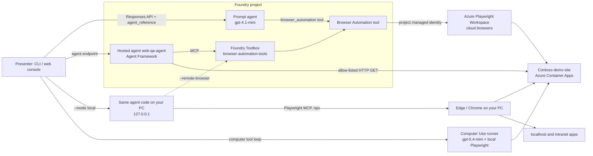

# Foundry Browser Automation demo (prompt agent · hosted agent · local · Computer Use)

End-to-end, deployable demo of the **Microsoft Foundry Browser Automation tool** (generally available since
October 2026). It shows the same configurable web tasks run four ways and compares them:

| Mode | What runs | Folder |
|---|---|---|
| **Prompt agent** | Foundry prompt agent + GA `BrowserAutomationTool` (azure-ai-projects SDK, Responses API) | [`src/prompt_agent`](src/prompt_agent) |
| **Hosted agent** | Agent Framework container on Foundry Agent Service, Browser Automation through a **Foundry Toolbox**, plus deterministic tools for HTTP security headers, page-source signals and broken links | [`src/hosted_agent`](src/hosted_agent) |
| **Local agent** | The hosted agent's code on your PC. The browser runs on your PC through the open-source Playwright MCP server (reaches `localhost` and intranet sites, no browser minutes), or in Azure with `--remote-browser` | [`src/hosted_agent`](src/hosted_agent) + [`src/demo_cli/local_agent.py`](src/demo_cli/local_agent.py) |
| **Computer Use** | Screenshot-driven `computer` tool loop (GA GPT-5.4+ models) executed with Playwright | [`src/computer_use`](src/computer_use) |

Everything runs against a purpose-built target site, **Contoso Insurance**
([`src/demo_site`](src/demo_site)), that has complex forms, a bug lab with 12 planted UI defects and a security
lab with 13 planted (harmless, fake) misconfigurations. Any other URL can be configured too.



## What is in the box

- **Infrastructure as code** (azd layers): `infra/foundry` (ejected with `azd ai agent init --infra`: Foundry account with
  `disableLocalAuth`, project, model deployments) and `infra/platform` (Playwright workspace, keyless
  `PlaywrightWorkspace` connection, RBAC, Application Insights + Log Analytics with a daily cap, Container Apps demo site,
  ACR and a monthly **budget** with alerts). Azure authentication is keyless; check your organization's policies before deployment.
- **Scenario catalog** ([`scenarios/`](scenarios)): 14 YAML scenarios from simple to expert (search, extraction, complex
  forms, validation recovery, UI bug hunting, accessibility review, smoke-test execution, passive security review,
  before/after hardening diff, open-web research). Each has a configurable URL and inputs, automatic success checks
  (including verifying submitted data through the site API), cost limits and, for QA and security, an answer key.
- **Demo CLI** (`python -m demo_cli`) and **web console** (`python -m web_console`): a two-column workspace with the
  run (step timeline, streamed answer, checks, tokens, cost) on the left and the browser preview on the right, plus
  mode comparisons, run history and costs. See [Web console](#web-console).
- **Reports** for every run in `runs/<timestamp>-<scenario>-<mode>/`: `report.md`, `events.jsonl`, `result.json`
  and screenshots for Computer Use, with token usage and an estimated cost.
- **Docs**: [tool deep dive](docs/01-browser-automation-tool.md) · [use cases & demo script](docs/02-use-cases-and-demo-script.md) ·
  [Computer Use vs Browser Automation](docs/03-computer-use-vs-browser-automation.md) · [cost management](docs/04-cost-management.md) ·
  [deployment in an Azure tenant](docs/05-deployment-mcaps.md) · [analysis of Sealjay/foundry-browser-use](docs/06-existing-repo-analysis.md) ·
  [security & responsible AI](docs/07-security-and-responsible-ai.md).

## Quick start

Prerequisites: Azure Developer CLI **1.37+** with the Foundry extensions (`azd ext install microsoft.foundry`),
Python **3.11+ (x64)**, Owner (or Contributor + Role Based Access Control Administrator) on the subscription, and quota
for `gpt-4.1-mini` (GlobalStandard) and `gpt-5.4-mini` (DataZoneStandard) in the chosen region.

```powershell
# 1. Sign in with the account that owns the target subscription (azd identity is used everywhere)
azd auth login --tenant-id <tenant-id>

# 2. Create an environment and provision (about 5 minutes)
azd env new browser-automation-demo --subscription <subscription-id> --location swedencentral
azd env set AZURE_TENANT_ID <tenant-id>
azd provision          # both infra layers + toolbox + .env

# 3. Deploy the demo site and the hosted agent
azd deploy

# 4. Local tooling
py -3.11 -m venv .venv; .\.venv\Scripts\Activate.ps1
pip install -e ".[ui,dev]"
python -m playwright install chromium     # only needed for Computer Use
python -m demo_cli doctor

# 5. Optional: local mode (the hosted agent's code on your PC; the local browser needs Node.js 18+)
py -3.11 -m venv src\hosted_agent\.venv
src\hosted_agent\.venv\Scripts\python -m pip install -r src\hosted_agent\requirements.txt
```

Signed in to several tenants? The CLI and console use the Azure CLI account that owns the environment's subscription
(`az account get-access-token --subscription`), even when your default account is in another tenant, and fall back to
azd. `azd deploy` and `azd provision` still need azd signed in to the target tenant (see
[docs/05](docs/05-deployment-mcaps.md)).

Run something:

```powershell
python -m demo_cli list
python -m demo_cli run 02-site-search --mode prompt
python -m demo_cli run 07-file-claim --mode hosted
python -m demo_cli run 05-find-agent --mode local --headed
python -m demo_cli run 09-ui-bug-hunt --mode cua --headed
python -m demo_cli run 01 --url https://learn.microsoft.com/azure/foundry/ --set bullets=3
python -m demo_cli ask --url https://example.com "What is this page about?"
python -m demo_cli compare 05-find-agent --modes prompt,hosted,cua,local
python -m demo_cli costs --azure
python -m web_console          # web console on http://127.0.0.1:8765 (also: python -m demo_cli ui)
```

## Web console

`python -m web_console` serves the console on http://127.0.0.1:8765 (`--port` to change it, `--open` to open it in your
browser). Pick a scenario (or write an ad-hoc task), set the start URL, the inputs (as fields or YAML) and the demo-site
target (the deployed site or another copy such as `http://localhost:8000`, like `--site-url`), choose the agent mode,
and press Run (Ctrl+Enter). The left column then shows the run: a step timeline, the streamed answer, the checks,
tokens and cost. The right column previews the browser by itself:

| Mode | Preview |
|---|---|
| Prompt, hosted, local with the cloud browser | The cloud browser's live view opens in a window placed beside the console when the agent starts its browser session (the live-view page cannot be embedded). Allow pop-ups for the console; otherwise a button opens it. Use Edge or Chrome: browser panels embedded in apps usually cannot open windows, and the console says so. |
| Local (browser on your PC) | Screenshots of the agent's browser about once a second, taken by a Playwright MCP `--init-page` hook that the agent never sees, so prompts and tokens are unchanged |
| Computer Use | Every screenshot the model acts on, with a filmstrip |

**Compare** runs one scenario in several modes one after another (saved to `runs/compare-*.md`, like
`demo_cli compare`), **History** opens any run's report, steps and screenshots, and **Costs** shows the estimates by
mode, model and scenario and, on request, the actual month-to-date Azure spend. One run at a time. The console listens on
loopback only, accepts only its own host and origin, requires a per-process token on its API, and never displays, logs
or saves the signed live-view link.

For cloud-browser runs, the run header and History detail show every observed `browserSessionId` with a **Copy**
button. IDs are retained in action arguments, `browser_session` events, `result.json` (`browser_session_ids`) and
the report so you can correlate an agent run with browser activity. Recovery can create more than one session.
Older runs and local/Computer Use browsers without a returned ID show no session ID. Treat these IDs as private
operational metadata; signed live-view and recording links remain redacted.

## Local mode

`--mode local` starts the hosted agent's own code (`src/hosted_agent/main.py`) on `127.0.0.1` for each run, calls it
over the same Responses protocol as the deployed agent, and then stops it together with the browser. The model stays
in your Foundry project; only the agent loop and the browser move to your PC.

| | Browser | Reaches | Browser cost | Use it for |
|---|---|---|---|---|
| `--mode local` | Edge (Windows) or Chrome on your PC, driven by the open-source [Playwright MCP](https://github.com/microsoft/playwright-mcp) server (`npx @playwright/mcp`, pinned) | Public sites **and** `localhost` / intranet apps | None | Testing an app on your machine, offline-ish demos, debugging with `--headed` |
| `--mode local --remote-browser` | Azure cloud browser through the Foundry Browser Automation tool (toolbox) | Public sites | Playwright minutes | Debugging the hosted agent before `azd deploy` |

Try the localhost case with the demo site itself:

```powershell
python -m uvicorn app:app --app-dir src\demo_site --port 8000          # terminal 1
python -m demo_cli run 07-file-claim --mode local --site-url http://localhost:8000   # terminal 2
```

`--site-url` points every `${DEMO_SITE_URL}` in the scenarios (start URLs and API checks) at that copy. The local
browser uses an in-memory profile (`--isolated`), never your own browser profile; code execution, `browser_evaluate`
and file upload are not exposed; message-content telemetry stays off; and the agent server listens on loopback only.
The Browser Automation tool itself has no local version: it is a managed Foundry tool whose browser always runs in
Azure. The server log of each local run is saved (redacted) as `local-agent.log` in the run folder.

## Testing in the Foundry portal

The prompt agents also work in the portal playground (Build > Agents): `browser-automation-agent` (gpt-4.1-mini) and
`browser-automation-agent-gpt-5-4-mini`. In a prompt agent, a failed browser action (for example `ToolTimeout`) ends
the turn with an error. The CLI recovers automatically; in the playground, reply "take a snapshot and continue" and the
agent picks up in the same browser session (sessions stay alive for 15 idle minutes). `python -m demo_cli agents
ensure` creates a new agent version whenever the instructions in this repo change, so edits made in the portal are
replaced on the next run.

## Scenario ladder

| Level | Scenario | Shows |
|---|---|---|
| 1 | `01-page-summary`, `02-site-search`, `03-extract-plans-table` | Navigate, use site search, extract a table to JSON |
| 2 | `04-compare-plans`, `05-find-agent`, `06-quote-calculator`, `14-public-web-research` | Filters, compare features, repeated form filling, bring-your-own URL |
| 3 | `07-file-claim`, `08-validation-recovery` | 4-step wizard with dependent dropdowns and conditional fields; recovering from validation errors; result verified through the site API |
| 4 | `09-ui-bug-hunt`, `10-accessibility-review`, `11-regression-smoke-test` | Exploratory QA with a defect table scored against an answer key, WCAG review, natural-language test plan |
| 5 | `12-passive-security-review`, `13-security-before-after` | Passive security review of a site you own (allow-listed), mapped to OWASP; before/after hardening diff |

Configure any scenario with `--url`, `--set key=value`, by editing the YAML, or in the console.
See [docs/02-use-cases-and-demo-script.md](docs/02-use-cases-and-demo-script.md) for talk tracks.

## Repository layout

```
azure.yaml                 azd project: ai-project, web-qa-agent (hosted), demo-site, infra layers, hooks
infra/foundry/             Foundry layer (generated by azd ai agent init --infra)
infra/platform/            Playwright workspace + connection, RBAC, monitoring, demo site, budget
hooks/                     postprovision (toolbox + .env) and postdeploy (smoke check + prompt agent)
scenarios/                 scenario catalog + answer keys
src/prompt_agent/          prompt agent definition (BrowserAutomationTool) and Responses runner
src/hosted_agent/          hosted agent (Agent Framework; browser backends: Foundry Toolbox in Azure or Playwright MCP locally; web analysis tools, audit middleware)
src/computer_use/          Computer Use loop and Playwright action executor
src/demo_common/           settings/credentials, scenarios, reporting, pricing, Responses stream handling
src/demo_cli/              CLI, hosted agent client, local-mode launcher, Azure cost query
src/web_console/           web console (FastAPI + vanilla JS modules, no build step): runs, live preview, compare, history, costs
src/demo_site/             Contoso Insurance target site (FastAPI)
tests/                     unit tests + browser end-to-end tests for the demo site and the web console
docs/                      guides
```

## Cost in one paragraph

Measured on `gpt-4.1-mini` in Sweden Central: a simple task such as `02-site-search` costs about $0.004 in tokens plus
one cloud-browser minute (about $0.01 per Linux browser minute; the first 100 minutes in a 30-day trial are free). The
hardest form, the 4-step `07-file-claim` wizard with 27 browser actions, costs about $0.03 in tokens (204K input tokens,
87% served from the prompt cache at a quarter of the price) plus three browser minutes on the hosted agent. Idle cost is
small: the demo site scales to zero, prompt agents cost nothing when idle, hosted agents scale to zero per session, and
the remaining fixed costs are a Basic container registry and log ingestion (capped at 1 GB/day). A monthly budget with
alerts covers both resource groups. Remove everything with `azd down --purge`. Details:
[docs/04-cost-management.md](docs/04-cost-management.md).

## Verified results

Measured in a test deployment (October 2026). Costs are estimates from `pricing.yaml` and token usage that was
cross-checked against Application Insights and Azure Monitor metrics.

| Scenario | Mode | Model | Result | Time | Browser actions | Est. cost |
|---|---|---|---|---|---|---|
| `02-site-search` | prompt | gpt-4.1-mini | 2/2 checks | 37 s | 8 | $0.014 |
| `02-site-search` | prompt | gpt-5.4-mini | 2/2 checks | 23 s | 8 | $0.019 |
| `02-site-search` | local (browser on the PC) | gpt-4.1-mini | 2/2 checks | 39 s | 3 | $0.006 |
| `05-find-agent` | prompt | gpt-4.1-mini | 2/2 checks | 33 s | 8 | $0.014 |
| `05-find-agent` | hosted | gpt-4.1-mini | 2/2 checks | 56 s | 8 | $0.017 |
| `05-find-agent` | Computer Use | gpt-5.4-mini | 2/2 checks | 33 s | 12 | $0.018 |
| `07-file-claim` | hosted | gpt-4.1-mini | 2/2 checks, claim verified through the API | 134 s | 27 | $0.06 |
| `07-file-claim` | local, site on `localhost:8000` | gpt-4.1-mini | 2/2 checks, claim verified through the local API | 47 s | 17 | $0.028 |
| `09-ui-bug-hunt` | hosted | gpt-4.1-mini | 1/2 checks, 5 of 12 planted defects | 646 s | 40 | $0.16 |
| `12-passive-security-review` | hosted | gpt-4.1-mini | 2/2 checks, 12 of 13 planted issues | 38 s | 3 tools | $0.015 |
| `13-security-before-after` | hosted | gpt-4.1-mini | 2/2 checks | 42 s | 4 | $0.015 |

Lessons that shaped the code (details in the docs):

- **Prompt Shields read task wording.** "relax only the language filter" was blocked as a jailbreak attempt before any
  tool call; neutral wording fixed it. Runs explain content-filter blocks instead of failing silently.
- **Refs, not selectors.** A guessed CSS selector raises `ToolTimeout`, which fails the whole response; instructions
  require snapshot refs and the runner continues with `previous_response_id`. Failed responses report no token usage.
- **Copy refs exactly.** After a navigation, refs carry a frame prefix (`f1e30`). In the portal playground
  `gpt-5.4-mini` shortened or reordered them (`e30`, `e1f30`); a malformed ref is treated as a selector that matches
  nothing, so every click timed out. The instructions now say to copy refs character for character, and the same
  scenario passes on `gpt-5.4-mini`. Tool errors are also returned to the hosted and local agent in full, so the model
  can read why an action failed.
- **Broken pages are slow, not expensive in tokens.** Each defective control in the bug lab costs about a minute of
  `ToolTimeout`, so browser minutes are two thirds of the `09` cost. The runners give QA scenarios a larger recovery
  budget (`max_recoveries`), the hosted agent tolerates more consecutive tool errors, and both agents check loading
  with snapshots instead of `browser_wait_for`.
- **Capacity is a rate limit.** Every call reserves `max_output_tokens` against the deployment's TPM, so long runs
  need headroom: both deployments use 300K TPM, and the prompt runner backs off when it hits a 429.
- **Hosted agent specifics.** Agent Framework must use `tool_result_content="content_first"` or the model never sees the
  accessibility snapshot; `src/hosted_agent/usage_fix.py` corrects reported usage that the current hosting package
  over-counts about tenfold, and `text_projection_fix.py` stops a divergent text snapshot from failing the whole
  response; message-content telemetry is off by default (`CAPTURE_MESSAGE_CONTENT`).
- **Computer Use sees pixels only.** It invented an article URL that was never on screen, and it must call the
  account-level `/openai/v1` endpoint because the project endpoint rejects full-size screenshot outputs.

## Responsible use

Browser agents act on live websites. This repo only fills forms on its own demo site, restricts security scenarios and
the hosted agent's HTTP tools to allow-listed hosts you own, blocks private addresses (SSRF), treats page content as
untrusted, gives the signed live-view link only to the presenter (printed in the terminal; the web console opens it in a
window without ever displaying it) and redacts it from every run artifact, and requires explicit acknowledgement of
Computer Use safety checks. Read
[docs/07-security-and-responsible-ai.md](docs/07-security-and-responsible-ai.md) before pointing it at other sites.
