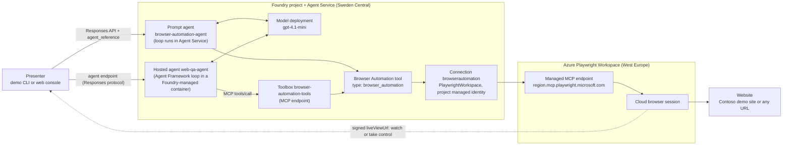
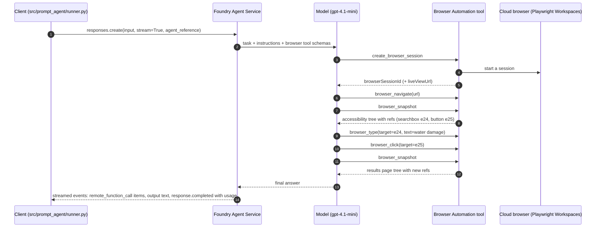

# 01 · The Browser Automation tool (GA): how it works and how this repo uses it

The **Browser Automation tool** lets a Microsoft Foundry agent operate a real, cloud-hosted browser. The agent opens a
session in an **Azure Playwright Workspace**, navigates, reads each page as an **accessibility snapshot**, and clicks,
types and fills forms by passing element **refs** from that snapshot (for example `e24`). The tool became **generally
available on 2026-10-19** for the new Foundry Agent Service (Responses API, prompt and hosted agents). Foundry runs the
agent loop server-side, so your client sends one request and streams events. You don't build a screenshot loop.
This page covers the architecture, the full tool list, prerequisites, the SDK and REST code this repo uses for the
**prompt agent** (`src/prompt_agent`) and the **hosted agent** (`src/hosted_agent`, through a Foundry Toolbox), **local
mode** (the hosted agent's code on your PC), supported models and regions, limits, known limitations, observability and
an FAQ.

**On this page:** [At a glance](#at-a-glance) · [Architecture](#architecture) · [How the loop works](#how-the-loop-works) ·
[Tool reference](#tool-reference) · [Prerequisites](#prerequisites-checklist) · [Prompt agent code](#prompt-agent-sdk-walkthrough) ·
[Hosted agent code](#hosted-agent-browser-automation-through-a-toolbox) ·
[Hosting known issues](#6-known-issues-in-the-current-preview-hosting-stack) · [Local mode](#local-mode-the-hosted-agents-code-on-your-pc) ·
[REST shapes](#rest-shapes) ·
[Models and regions](#supported-models-and-regions) · [Limits](#limits) · [Limitations](#limitations-and-how-to-handle-them) ·
[Observability](#observability) · [FAQ](#faq)

---

## At a glance

| | |
|---|---|
| **Status** | GA since 2026-10-19 ([announcement](https://devblogs.microsoft.com/foundry/browser-automation-tool-ga/), [Learn](https://learn.microsoft.com/azure/foundry/agents/how-to/tools/browser-automation)). GA covers **new Foundry agents** only (Responses API: prompt and hosted agents). Classic agents (`azure-ai-agents`, threads/runs) stay preview ([classic doc](https://learn.microsoft.com/azure/foundry-classic/agents/how-to/tools-classic/browser-automation-samples)). |
| **Python SDK** | `azure-ai-projects >= 2.8.0` (this repo pins `>= 2.9.0`): `BrowserAutomationTool`, `BrowserAutomationToolParameters`, `BrowserAutomationToolConnectionParameters`. The toolbox variant is `BrowserAutomationToolboxTool`. Preview names were `BrowserAutomationPreviewTool` / `browser_automation_preview`. |
| **REST tool type** | `"browser_automation"` |
| **Browser infrastructure** | Azure Playwright Workspaces (`Microsoft.LoadTestService/playwrightWorkspaces`), reached through the workspace's **managed MCP endpoint** |
| **Authentication** | Foundry project connection (category `PlaywrightWorkspace`). This repo uses `ProjectManagedIdentity` (keyless). Alternatives: `AgenticIdentityToken`, `ApiKey`. |
| **What the model sees** | Accessibility-tree text from `browser_snapshot` / `browser_find`. Screenshots are evidence only. |
| **Who runs the loop** | Foundry Agent Service (prompt agent) or your hosted agent's framework (hosted agent). The tool's browser actions always run in the cloud browser, never on your machine: the tool has no local version. This repo's [local mode](#local-mode-the-hosted-agents-code-on-your-pc) swaps in the open-source Playwright MCP server instead. |
| **What you pay** | No separate tool fee. You pay for Playwright browser minutes and model tokens ([cost considerations](https://learn.microsoft.com/azure/foundry/agents/how-to/tools/browser-automation#cost-considerations)). See [04-cost-management.md](04-cost-management.md). |

---

## Architecture



- **Prompt agent.** The tool is attached to the agent definition. One `responses.create` call starts the loop. Foundry
  calls the model, runs each browser action and feeds the result back until the model answers.
- **Hosted agent.** Your container (here: Agent Framework) runs the loop. It reaches the same tool through a **Foundry
  Toolbox**, which exposes it as a managed MCP endpoint. Tools show up with the prefix `browserautomation___`, and the
  hosted agent exposes a curated subset of them to its model. It also has three deterministic tools of its own (HTTP
  headers, page source, links). See [the hosted agent section](#hosted-agent-browser-automation-through-a-toolbox).
- **One connection for both.** Both agents use the project connection `browserautomation`. It targets the workspace's MCP
  endpoint and authenticates with the **project's managed identity**. No keys are involved.
- **Live view.** `create_browser_session` returns a signed `liveViewUrl`. Anyone with the link can watch the session and
  take control of it. Treat it as a secret ([07-security-and-responsible-ai.md](07-security-and-responsible-ai.md)).
- **Regions can differ.** This deployment runs the Foundry project in Sweden Central and the Playwright workspace in
  West Europe. That combination is verified working.

---

## How the loop works



1. **Observe, act, observe again.** The model calls `browser_snapshot` to get the accessibility tree, picks a ref, acts
   (`browser_click`, `browser_type`, `browser_select_option`, ...), then takes a fresh snapshot after anything that
   changes the page. `browser_find` searches the snapshot for text without returning the whole tree.
2. **Refs, not selectors.** Pass the ref from the latest snapshot as `target`, copied character for character (`e24`,
   or `f1e30` with a frame prefix; [see why](#copy-refs-exactly-frame-prefixes)).
   Don't invent CSS selectors or attributes the snapshot didn't show. Both the official sample prompt and this repo's
   instructions require this.
3. **Screenshots are evidence only.** The tool description says so: *"You cannot perform actions based on the screenshot;
   use browser_snapshot for actions."*
4. **Your client doesn't execute anything.** The prompt-agent client makes one streaming call and observes events. Each
   browser action arrives as a `response.output_item.done` event whose item type is **`remote_function_call`**, with
   `name`, `call_id` and `arguments` (a JSON string that includes `browserSessionId`). Contrast this with Computer Use,
   where your code has to execute every click ([03-computer-use-vs-browser-automation.md](03-computer-use-vs-browser-automation.md)).

### A measured run

`python -m demo_cli run 02-site-search --mode prompt` on `gpt-4.1-mini` finished in **37 s** with **8 browser actions**,
**8,324 input / 513 output tokens**, both success checks passed, and an estimated cost of about **$0.004 model + $0.01
browser minute**. These are the actions from `runs/<timestamp>-02-site-search-prompt/report.md`:

```text
1. create_browser_session {}
2. browser_navigate       {"url": "https://<demo-site>"}
3. browser_snapshot       {}
4. browser_type           {"target": "e24", "text": "water damage"}
5. browser_click          {"target": "e25"}
6. browser_snapshot       {}
7. browser_click          {"target": "f1e30"}
8. browser_snapshot       {}
```

### Why refs matter: the measured failure

The first attempt at the same scenario failed. `gpt-4.1-mini` guessed a selector instead of using a ref:

```text
browser_fill_form {"fields": [{"target": "[aria-label=\"What do you need help with?\"]", "value": "water damage"}]}
```

The search box has no `aria-label`. It's labelled by `<label for="q">`. The run ended after about 110 s with:

```text
An error occurred invoking 'browser_fill_form': ToolTimeout: The browser action timed out before the page was ready
for it. Take a snapshot to check the current page state, then decide whether to retry.
{"toolName": "browser_fill_form", "error": {"code": "ToolTimeout", ..., "retryable": false}}
```

The platform then **failed the whole response**, so the model never got a chance to retry. Two fixes went in:

1. **Instructions.** [`src/prompt_agent/instructions.md`](../src/prompt_agent/instructions.md) now says to target refs
   from the latest snapshot and never invent selectors.
2. **Runner recovery.** [`src/prompt_agent/runner.py`](../src/prompt_agent/runner.py) continues from the failed
   response with `previous_response_id` and a prompt that asks for a fresh snapshot. The number of continuations is
   the scenario's `limits.max_recoveries`: 2 by default, 6 for `09-ui-bug-hunt`, 4 for `11-regression-smoke-test`.

With both fixes the next run completed on the first try.

A second kind of `ToolTimeout` showed up on `05-find-agent`: after 8 browser calls, `browser_wait_for` waited for text
that never appeared and the response failed. `responses.retrieve(<id>)` then returns `status: failed`,
`error.code: tool_user_error` and **`usage: None`**. The runner recovered with `previous_response_id` and the run passed,
but the model turns of the failed response appear in no API usage even though they're billed. Both instruction files
now say: check whether content has loaded with a fresh `browser_snapshot`, not `browser_wait_for` with text, and after
two failed attempts on the same element, record a defect and move on. Check real consumption in Azure Monitor metrics
([04](04-cost-management.md#see-actual-spend)).

On a deliberately broken UI (`09-ui-bug-hunt`) these timeouts add up: each action on a defective control, and each wait
for text that never appears, ends with a `ToolTimeout` after **about 60 seconds**. The prompt agent's first `09` run hit
three of them (two `browser_wait_for`, one `browser_click`), used up its 2 recoveries and failed after 243.8 s with 14
tool calls and 0 reported tokens, because every response failed. That's why `09` now allows 6 recoveries.

With the new instructions and 6 recoveries, the prompt agent completed `09` in 81.5 s (17 tool calls, about $0.026) but
reported only 1 of the 12 defects: the model ended its turn with a plan (*"I will now bypass this issue by switching
the claim type …"*) instead of carrying it out. The hosted agent reported 5 of 12 on the same scenario. Exploratory QA
needs the hosted agent's long-running loop and stronger instructions, or several focused prompt runs (one per wizard
step).

### Copy refs exactly: frame prefixes

After a navigation, refs can carry a **frame prefix**: after the search submit in `02`, the results page's refs were
`f1e28`, `f1e30` and so on. In the Foundry portal playground, `browser-automation-agent` (switched to `gpt-5.4-mini` in
the portal) failed three runs of the `02` task with `ToolTimeout` on `browser_click`. The prompt agent's spans in
Application Insights (cloud role `responsesapi`, span `execute_tool remote_mcp_browserautomation.browser_click`,
attribute `gen_ai.tool.call.arguments`) showed why: the model clicked `e1f30`, `e1e30` and `e30`. A malformed ref is
treated as a selector that matches nothing, so the action waits until it times out, and in a prompt agent that ends the
turn.

Both instruction files now say to copy refs character for character, with this example. Verified afterwards: the
prompt agent on `gpt-5.4-mini` (`--strong`) clicked `f1e30` and passed 2/2 in 23.2 s (7,615 input / 554 output tokens,
about $0.019 including one browser minute), and the hosted agent (version 6) also clicked `f1e30` and passed 2/2 in
34.9 s (about $0.018).

**In the portal playground**, nothing recovers a failed browser action for you: the prompt agent's turn ends with the
error. Reply "take a snapshot and continue", and the agent picks up in the same browser session, which stays alive for
15 idle minutes. The CLI does this automatically ([runner recovery](#4-recover-from-a-failed-browser-action)).

---

## Tool reference

This is the tool list returned by this repo's live toolbox. Through a toolbox, every name carries the
`browserautomation___` prefix. Every tool except `create_browser_session` takes a required `browserSessionId`. The
**Hosted** column shows which tools the hosted agent exposes to its model by default (`BROWSER_TOOLS`, defaults in
[`browser_backend.py`](../src/hosted_agent/browser_backend.py)). The prompt agent gets every tool. Local mode uses
Playwright MCP's own tools instead ([local mode](#local-mode-the-hosted-agents-code-on-your-pc)).

| Group | Tool | What it does | Key parameters | Hosted | Notes |
|---|---|---|---|---|---|
| Session | `create_browser_session` | Starts a remote Playwright browser session and returns `browserSessionId` | `proxyConfig` (object, optional) | ✓ | Returns a signed, opaque `liveViewUrl` (treat as a secret) and optionally a `recordingUrl`. `proxyConfig` supports a Key Vault `secretUri` for proxy credentials. |
| Session | `close_browser_session` | Closes the session and disconnects the browser | `browserSessionId` | ✓ | A closed session can't be reopened. |
| Navigate | `browser_navigate` | Opens a URL | `url` | ✓ | URL max 16 KiB |
| Navigate | `browser_navigate_back` | Goes back in history | | ✓ | |
| Navigate | `browser_tabs` | Lists, creates, closes or selects tabs | `action`, `index`, `url` | | |
| Observe | `browser_snapshot` | Accessibility snapshot; the basis for choosing targets | `target`, `depth`, `boxes` | ✓ | Text is truncated at 64 KiB. Use `target`/`depth` to scope it. |
| Observe | `browser_find` | Searches the snapshot for text and returns matching nodes with surrounding context | `text` | ✓ | Cheaper than a full snapshot |
| Observe | `browser_wait_for` | Waits for text to appear or disappear, or for a time to pass | `text`, `textGone`, `time` | ✓ | Max 180 s |
| Observe | `browser_take_screenshot` | Screenshot of the page or an element | `target`, `type`, `fullPage`, `scale` | | Evidence only, not for targeting. Inline base64 max 768 KiB. |
| Act | `browser_click` | Clicks an element | `target`, `button`, `doubleClick`, `modifiers` | ✓ | |
| Act | `browser_type` | Types into an editable element | `target`, `text`, `submit`, `slowly` | ✓ | `submit=true` presses Enter |
| Act | `browser_fill_form` | Fills several fields in one call | `fields[]` | ✓ | *"A failure can leave earlier fields updated."* |
| Act | `browser_select_option` | Selects options in a dropdown | `target`, `values[]` | ✓ | |
| Act | `browser_press_key` | Presses a key | `key` | ✓ | |
| Act | `browser_hover` | Hovers over an element | `target` | | |
| Act | `browser_drag` | Drag and drop between two elements | `startTarget`, `endTarget` | | |
| Act | `browser_handle_dialog` | Accepts or dismisses a blocking dialog | `accept`, `promptText` | ✓ | |
| Act | `browser_file_upload` | Uploads base64 files through a file chooser or input | `files[]`, `target` | | 1 to 20 files, 10 MiB / 50 MiB combined (verify exact semantics) |
| Diagnose | `browser_console_messages` | Bounded console messages for the active page | | ✓ | Good for UI bug evidence |
| Diagnose | `browser_network_requests` | Bounded network requests since the page loaded | | ✓ | Shows failing calls (4xx/5xx). Don't rely on it for full response headers (verify). |
| Code | `browser_evaluate` | Evaluates JavaScript on the page or an element | `function`, `target` | | *"Page content and state may be exposed or changed."* The prompt agent's instructions allow read-only use. |
| Code | `browser_run_code` | Runs a Playwright code snippet | `code` | | *"Unsafe ... RCE-equivalent within that worker."* Forbidden by the prompt agent's instructions. |

Microsoft's guidance is to treat page content, snapshots, console and network output as untrusted, and **not to enable
`browser_evaluate` or `browser_run_code` by default** ([Playwright Workspaces remote MCP](https://learn.microsoft.com/azure/app-testing/playwright-cloud-browsers/how-to-playwright-workspaces-remote-mcp)).

---

## Prerequisites checklist

- [ ] **A new Foundry resource and project.** The resource is kind `AIServices` with `allowProjectManagement`, and the
      project has a system-assigned identity. Hub-based projects don't qualify. In this repo: `infra/foundry` (generated
      by `azd ai agent init --infra`), with `disableLocalAuth: true`.
- [ ] **A supported model deployment.** This repo uses `gpt-4.1-mini` (see [models](#supported-models-and-regions)).
- [ ] **A Playwright workspace** (`Microsoft.LoadTestService/playwrightWorkspaces@2025-09-01`) in one of the supported
      regions. In this repo: `infra/platform/modules/playwright.bicep`, default `westeurope`, `localAuth: 'Disabled'`.
- [ ] **RBAC on the workspace.** Assign **Playwright Workspace Contributor** (`78cf819f-0969-4ebe-8759-015c6efcd5bf`) to
      the project managed identity for `ProjectManagedIdentity` auth, or to the hosted agent's identity for
      `AgenticIdentityToken`. This repo also grants it to you, for local raw-Playwright experiments.
- [ ] **A project connection** with category `PlaywrightWorkspace`. Build the target from the workspace `dataplaneUri`:
      replace `.api.playwright.microsoft.com` with `.mcp.playwright.microsoft.com` and append `/mcp`. Set the audience to
      `https://mcp.playwright.microsoft.com` and `metadata.resourceId` to the workspace ID. In this repo:
      `infra/platform/modules/foundry-wiring.bicep`.
- [ ] **Your own roles on the project.** **Foundry User** (`53ca6127-db72-4b80-b1b0-d745d6d5456d`) to run agents, and
      **Foundry Project Manager** (`eadc314b-1a2d-4efa-be10-5d325db5065e`) to create connections, agents and toolboxes.
      Bicep assigns both to the principal running `azd`. Provisioning the workspace itself needs Contributor (or Owner)
      on the resource group. Computer Use additionally needs an inference role on the account, which Bicep also assigns
      ([03](03-computer-use-vs-browser-automation.md#dependencies)).
- [ ] **SDK:** `pip install "azure-ai-projects>=2.8.0" azure-identity`.
- [ ] **Hosted agents only:** a **toolbox** containing a `browser_automation` tool, published. This repo creates it in
      `hooks/postprovision.ps1`.
- [ ] **Optional:** an Application Insights connection for tracing (`appinsights` in this repo).

The project connection ID you pass to the tool is the connection's ARM ID, which `azd` stores as
`BROWSER_AUTOMATION_PROJECT_CONNECTION_ID`:

```text
/subscriptions/<sub>/resourceGroups/rg-<env>-foundry/providers/Microsoft.CognitiveServices/accounts/<account>/projects/<project>/connections/browserautomation
```

### Infrastructure as code (from this repo)

```bicep
// infra/platform/modules/playwright.bicep (abridged)
resource workspace 'Microsoft.LoadTestService/playwrightWorkspaces@2025-09-01' = {
  name: workspaceName
  location: location                      // westeurope by default (PLAYWRIGHT_LOCATION)
  properties: {
    regionalAffinity: 'Enabled'
    localAuth: localAuth                  // 'Disabled' by default: Entra ID only, no access tokens
  }
}

resource projectRoleAssignment 'Microsoft.Authorization/roleAssignments@2022-04-01' = {
  name: guid(workspace.id, foundryProjectPrincipalId, playwrightWorkspaceContributorRoleId)
  scope: workspace
  properties: {
    principalId: foundryProjectPrincipalId   // the Foundry project's system-assigned identity
    principalType: 'ServicePrincipal'
    roleDefinitionId: subscriptionResourceId('Microsoft.Authorization/roleDefinitions', '78cf819f-0969-4ebe-8759-015c6efcd5bf')
  }
}
```

```bicep
// infra/platform/modules/foundry-wiring.bicep (abridged)
resource browserAutomationConnection 'Microsoft.CognitiveServices/accounts/projects/connections@2025-04-01-preview' = {
  parent: account::project
  name: browserAutomationConnectionName   // 'browserautomation'
  properties: {
    category: 'PlaywrightWorkspace'
    target: '${replace(playwrightDataplaneUri, '.api.playwright.microsoft.com', '.mcp.playwright.microsoft.com')}/mcp'
    authType: 'ProjectManagedIdentity'
    audience: 'https://mcp.playwright.microsoft.com'
    isSharedToAll: true
    credentials: null
    metadata: {
      resourceId: playwrightWorkspaceId
    }
  }
}
```

This is the same connection shape as the official `14-browser-automation-agent` sample in
[microsoft-foundry/foundry-samples](https://github.com/microsoft-foundry/foundry-samples/tree/main/samples/python/hosted-agents/agent-framework/responses/14-browser-automation-agent).

---

## Prompt agent: SDK walkthrough

Code: [`src/prompt_agent/agent.py`](../src/prompt_agent/agent.py) and [`src/prompt_agent/runner.py`](../src/prompt_agent/runner.py).
Credentials come from `demo_common.settings.get_credential()`: the Azure CLI account that owns `AZURE_SUBSCRIPTION_ID`,
then azd, then the Azure CLI's default account, then the other `DefaultAzureCredential` sources, with each failure
falling through to the next source. See [05](05-deployment-mcaps.md#1-sign-in-with-azd-to-the-external-tenant) for why.

### 1. Define the tool and create an agent version

```python
from azure.ai.projects import AIProjectClient
from azure.ai.projects.models import (
    AgentVersionDetails,
    BrowserAutomationTool,
    BrowserAutomationToolConnectionParameters,
    BrowserAutomationToolParameters,
    PromptAgentDefinition,
)

def build_definition(settings: Settings, model: str) -> PromptAgentDefinition:
    if not settings.browser_connection_id:
        raise RuntimeError("BROWSER_AUTOMATION_PROJECT_CONNECTION_ID is not set. Run `azd provision`.")
    tool = BrowserAutomationTool(
        browser_automation=BrowserAutomationToolParameters(
            connection=BrowserAutomationToolConnectionParameters(project_connection_id=settings.browser_connection_id)
        )
    )
    return PromptAgentDefinition(model=model, instructions=INSTRUCTIONS, tools=[tool])
```

Agent versions are immutable, so `ensure_prompt_agent` only creates a new version when the model, instructions or
connection changed. It stores a hash of the definition in the version metadata:

```python
    if not force_new_version:
        try:
            latest = next(iter(client.agents.list_versions(name, limit=1, order="desc")), None)
        except ResourceNotFoundError:
            latest = None
        if latest is not None and (latest.metadata or {}).get("definition_hash") == digest:
            return latest
    return client.agents.create_version(
        name,
        definition=build_definition(settings, model),
        description="Browser automation demo agent (GA Browser Automation tool + Playwright Workspaces).",
        metadata={"definition_hash": digest, "managed_by": MANAGED_BY, "model": model},
    )
```

Agent names: `browser-automation-agent` for the default model, and `browser-automation-agent-gpt-5-4-mini` for the
stronger model (`--strong`). Create or refresh them with `python -m demo_cli agents ensure`. The `postdeploy` hook runs
this too when the repo's `.venv` exists. Otherwise the agent is created on the first prompt-mode run.

### 2. Run a task: Responses API with an agent reference

```python
        client = project_client(settings)
        agent = ensure_prompt_agent(settings, model, client=client)
        limits = rendered.limits
        openai_client = client.get_openai_client().with_options(timeout=float(limits.timeout_seconds), max_retries=1)
        reference = {"agent_reference": {"name": agent.name, "version": agent.version, "type": "agent_reference"}}
        optional = {"max_output_tokens": limits.max_output_tokens, "max_tool_calls": limits.max_tool_calls}

        stream = create_with_fallback(openai_client, {"input": rendered.task, "stream": True, "extra_body": reference}, optional, recorder)
        outcome = consume_stream(stream, recorder)
```

- `get_openai_client()` returns an OpenAI client whose base URL is `{FOUNDRY_PROJECT_ENDPOINT}/openai/v1`.
- The agent is selected with `agent_reference`, sent through `extra_body`. Model, instructions and tools come from the
  agent version.
- `max_output_tokens` and `max_tool_calls` come from the scenario's `limits` block.
  [`create_with_fallback`](../src/demo_common/responses_stream.py) drops any of them that the endpoint rejects and logs a
  warning. Whether `max_tool_calls` also caps Browser Automation's remote calls isn't documented (verify).

### 3. Read the stream

Condensed from [`src/demo_common/responses_stream.py`](../src/demo_common/responses_stream.py):

```python
TOOL_ITEM_TYPES = {"remote_function_call", "function_call", "mcp_call", "custom_tool_call", "computer_call", "web_search_call"}

for event in stream:
    if event.type == "response.created":
        outcome.response_id = event.response.id             # kept for recovery
    elif event.type == "response.output_item.done" and event.item.type in TOOL_ITEM_TYPES:
        recorder.action(event.item.name, _json(event.item.arguments))   # browserSessionId retained for correlation
    elif event.type == "response.output_text.done":
        recorder.detect_live_view(event.text)              # the live view link arrives as text
    elif event.type in ("response.completed", "response.incomplete"):
        recorder.add_usage(event.response.usage)           # tokens for the cost estimate
    elif event.type == "response.failed":
        outcome.status, outcome.error = "failed", f"Response failed: {event.response.error}"
```

| Event | What it carries | What the runner does |
|---|---|---|
| `response.created` | Response ID | Kept for `previous_response_id` recovery |
| `response.output_item.done`, item `remote_function_call` | One browser action: `name`, `call_id`, `arguments` | Logged as an action (session ID removed) |
| `response.output_text.delta` / `.done` | Text, including the live view message and the final answer | Streamed to the terminal or the web console; live view link detected |
| `response.completed` / `response.incomplete` | `usage` | Tokens recorded |
| `response.failed` / `error` | For example, `ToolTimeout` | Triggers recovery |

The hosted agent streams `function_call` / `mcp_call` items instead. The same code handles both.

### 4. Recover from a failed browser action

```python
RECOVERY_PROMPT = (
    "The previous browser action failed with this error: {error}\n"
    "Do not start over. Take a fresh browser_snapshot of the current page (create a new browser session and navigate "
    "back to {url} only if the session is gone), target elements by the refs from that snapshot, and continue the "
    "original task until it is complete. If the same element failed before, record it as a defect and move on "
    "instead of retrying it. Then give the final answer in the requested format."
)
...
        while outcome.error and attempts < limits.max_recoveries:   # per scenario, default 2
            attempts += 1
            if "rate limit" in outcome.error.lower():
                # The agent's server-side tool loop surfaces model 429s as stream errors; back off before continuing.
                delay = min(20 * attempts, 60)
                recorder.emit("warning", f"Model deployment rate limit reached; waiting {delay}s before continuing.")
                time.sleep(delay)
            prompt = RECOVERY_PROMPT.format(error=outcome.error[:400], url=rendered.url)
            params = {"input": prompt, "stream": True, "extra_body": reference}
            if outcome.response_id:
                params["previous_response_id"] = outcome.response_id
            else:
                params["input"] = f"{rendered.task}\n\n{prompt}"
```

If `previous_response_id` can't be used, the runner restarts with the original task plus the recovery prompt. A 429
from the server-side loop arrives as a stream error too; the runner then waits 20 s × attempt (at most 60 s) before
continuing.

---

## Hosted agent: Browser Automation through a Toolbox

A hosted agent doesn't declare `BrowserAutomationTool` itself. It connects as an MCP client to a **Foundry Toolbox** that
contains the tool. That's the pattern in the
[hosted-agent quickstart](https://learn.microsoft.com/azure/foundry/agents/how-to/tools/browser-automation-hosted-agent-quickstart)
and the official `14-browser-automation-agent` sample. A toolbox lets you reuse a tool across agents and runtimes and
centralizes credentials, versioning and policy ([toolbox doc](https://learn.microsoft.com/azure/foundry/agents/how-to/tools/toolbox)).
Computer Use can't be put in a toolbox ([supported tools](https://learn.microsoft.com/azure/foundry/agents/concepts/toolbox-overview#supported-tools)).
The same code also runs on your PC, with this toolbox or with a local browser
([local mode](#local-mode-the-hosted-agents-code-on-your-pc)).

### 1. Create and publish the toolbox (postprovision hook)

From [`hooks/postprovision.ps1`](../hooks/postprovision.ps1). It uses **azd's** token, so it works even when the Azure CLI
is signed in to a different tenant:

```powershell
$token = (azd auth token --scope "https://ai.azure.com/.default" --output json | ConvertFrom-Json).token
$headers = @{ Authorization = "Bearer $token"; 'Content-Type' = 'application/json' }
$body = @{
    description = 'GA Browser Automation tool backed by the demo Playwright workspace'
    tools = @(
        @{
            type = 'browser_automation'
            browser_automation = @{ connection = @{ project_connection_id = $connectionId } }
        }
    )
} | ConvertTo-Json -Depth 6 -Compress

$created = Invoke-RestMethod -Method POST -Headers $headers -Body $body `
    -Uri "$projectEndpoint/toolboxes/$toolboxName/versions?api-version=v1"   # retried 5x every 15 s (RBAC propagation)
azd ai toolbox publish $toolboxName $created.version --project-endpoint $projectEndpoint --no-prompt
azd env set TOOLBOX_ENDPOINT "$projectEndpoint/toolboxes/$toolboxName/mcp?api-version=v1"
```

### 2. Connect from Agent Framework

Condensed from [`main.py`](../src/hosted_agent/main.py):

```python
from agent_framework import Agent, ContextWindowCompactionStrategy
from agent_framework.foundry import FoundryChatClient
from agent_framework_foundry_hosting import ResponsesHostServer

from audit import tool_audit
from browser_backend import browser_backend, create_browser_tool, local_snapshot_middleware, select_sections
from dev_credential import build_credential
from text_projection_fix import apply as apply_text_projection_fix
from usage_fix import apply as apply_usage_fix
from web_tools import WEB_TOOLS, allowed_hosts

apply_usage_fix()              # see "Known issues" below
apply_text_projection_fix()

BROWSER_BACKEND = browser_backend()      # BROWSER_BACKEND: "toolbox" (default, the only option in Foundry) or "local"
INSTRUCTIONS = select_sections((Path(__file__).parent / "instructions.md").read_text(encoding="utf-8"), BROWSER_BACKEND)

# One credential for the process; tokens are cached and refreshed by azure-identity. Managed identity in Foundry;
# locally, AZURE_CLI_SUBSCRIPTION (set by demo_cli's local mode) selects the Azure CLI account for that subscription.
credential = build_credential()


def create_agent() -> Agent:
    """Factory used by the hosting server: a fresh agent (and browser tool session) per request."""
    tools: list = []
    middleware: list = [tool_audit]
    browser_tool = create_browser_tool(BROWSER_BACKEND, credential)
    if browser_tool is not None:
        tools.append(browser_tool)
        if BROWSER_BACKEND == "local":
            middleware.append(local_snapshot_middleware(browser_tool))
    tools.extend(WEB_TOOLS)

    client = FoundryChatClient(
        project_endpoint=os.environ["FOUNDRY_PROJECT_ENDPOINT"],
        model=os.environ["AZURE_AI_MODEL_DEPLOYMENT_NAME"],
        credential=credential,
    )
    # Browser actions on a broken page fail by design (QA scenarios); the default of 3 consecutive tool errors stops
    # the tool loop too early.
    client.function_invocation_configuration["max_consecutive_errors_per_request"] = int(
        os.getenv("MAX_CONSECUTIVE_TOOL_ERRORS", "6")
    )
    # Let the model read why a browser action failed ("does not match any elements", "timed out ... take a snapshot")
    # instead of a generic error; it otherwise keeps retrying blindly. The model runs in your own Foundry project.
    client.function_invocation_configuration["include_detailed_errors"] = (
        os.getenv("DETAILED_TOOL_ERRORS", "true").strip().lower() in ("1", "true", "yes")
    )
    allow = ", ".join(allowed_hosts()) or "(none configured)"
    return Agent(
        client=client,
        name="web-qa-agent",
        instructions=INSTRUCTIONS.replace("{{ALLOWED_SCAN_HOSTS}}", allow),
        tools=tools,
        middleware=middleware,
        # Old browser snapshots are stale once the page changes: evict old tool results when the context grows.
        compaction_strategy=ContextWindowCompactionStrategy(
            max_context_window_tokens=int(os.getenv("CONTEXT_BUDGET_TOKENS", "48000")),
            max_output_tokens=4000,
            keep_last_tool_call_groups=4,
        ),
        # Conversation history is managed by the hosting infrastructure.
        default_options={"store": False},
    )


def main() -> None:
    # The hosted container must listen on all interfaces; the local launcher binds 127.0.0.1 (AGENT_HOST), and the
    # local browser backend defaults to loopback so a dev machine never exposes the agent on the network by accident.
    host = os.getenv("AGENT_HOST") or ("127.0.0.1" if BROWSER_BACKEND == "local" else "0.0.0.0")
    ResponsesHostServer(agent=create_agent).run(host=host)
```

The toolbox branch of [`browser_backend.py`](../src/hosted_agent/browser_backend.py) (the local branch is under
[local mode](#local-mode-the-hosted-agents-code-on-your-pc)):

```python
# Browser tools exposed to the model. Fewer tools mean smaller prompts and a smaller attack surface: code execution
# (browser_run_code / browser_run_code_unsafe), browser_evaluate, file upload and screenshots are never exposed by
# default.
DEFAULT_TOOLBOX_TOOLS = (
    "create_browser_session,browser_navigate,browser_navigate_back,browser_snapshot,browser_find,browser_click,"
    "browser_type,browser_fill_form,browser_select_option,browser_press_key,browser_wait_for,browser_handle_dialog,"
    "browser_console_messages,browser_network_requests,close_browser_session"
)


def allowed_tool_names(backend: str) -> list[str]:
    if backend == "local":
        return _names(os.getenv("LOCAL_BROWSER_TOOLS", DEFAULT_LOCAL_TOOLS))
    prefix = os.getenv("BROWSER_TOOL_PREFIX", "browserautomation")
    return [f"{prefix}___{name}" for name in _names(os.getenv("BROWSER_TOOLS", DEFAULT_TOOLBOX_TOOLS))]


def create_browser_tool(backend: str, credential):
    """The MCP tool that gives the agent a browser, or None when no browser is configured."""
    if backend == "local":
        ...  # MCPStdioTool running Playwright MCP, see "Local mode"
    if os.getenv("TOOLBOX_ENDPOINT") or os.getenv("TOOLBOX_NAME"):
        # The Browser Automation tools return the accessibility snapshot in `content` and only metadata in
        # `structuredContent`; Agent Framework defaults to structured_first, which would hide the snapshot.
        return FoundryToolbox(credential, tool_result_content="content_first", allowed_tools=allowed_tool_names("toolbox"))
    return None
```

- **Toolbox client.** `FoundryToolbox` resolves `TOOLBOX_ENDPOINT`, or builds
  `{FOUNDRY_PROJECT_ENDPOINT}/toolboxes/{TOOLBOX_NAME}/mcp?api-version=v1`. It discovers tools with MCP `tools/list`, so
  no browser tool schema is hardcoded. It gets tokens for `https://ai.azure.com/.default`, sends the header
  `Foundry-Features: Toolboxes=V1Preview`, and uses a 120 s request timeout by default. Extra keyword arguments go to
  Agent Framework's MCP tool.
- **Curated tools.** `allowed_tools` exposes 15 of the 22 browser tools (the **Hosted** column in the
  [tool reference](#tool-reference)). `browser_run_code`, `browser_evaluate`, file upload, screenshots, hover, drag and
  tabs stay hidden. Change the list with the `BROWSER_TOOLS` environment variable (comma-separated short names).
- **One code base, two browsers.** `BROWSER_BACKEND` selects the browser tool: `toolbox` (default, and the only option
  in Foundry) or `local` (Playwright MCP, for local runs only: the hosted container has no Node.js).
  `instructions.md` keeps backend-specific text in `<!-- browser:toolbox -->` and `<!-- browser:local -->` blocks, and
  `select_sections()` keeps the matching ones at start-up.
- **`tool_result_content="content_first"` is required (verified).** The Browser Automation tools return the
  accessibility snapshot in the MCP `content`, while `structuredContent` only carries the URL and title. Agent
  Framework's default, `structured_first`, therefore hands the model a result **without the snapshot and without any
  refs**, and it starts guessing selectors.
- **Context compaction is a safety net.** An Agent Framework loop runs client-side and resends the whole conversation
  on every model call, and old snapshots go stale once the page changes. The compaction strategy evicts old tool
  results once the context passes `CONTEXT_BUDGET_TOKENS` (default 48,000) and keeps the last 4 tool-call groups. In the
  measured runs it **never triggered**: Browser Automation snapshots are compact, and the hosted agent's context stayed
  between about 3K and 12K tokens per model call. It protects long runs; it isn't where the savings came from.
- **Measured effect of the allow-list.** On `07-file-claim` (`gpt-4.1-mini`, token counts from the agent's
  Application Insights spans), exposing 15 instead of 22 browser tools went from 27 model calls with 223,930 input
  tokens to 24 calls with 174,538 (**−22%**), thanks to smaller tool schemas on every call and fewer calls.
- **The reference run.** After the usage fix below, `07-file-claim` on the hosted agent in the external tenant took
  133.6 s with 27 tool calls and 28 model calls: 204,393 input tokens (87% prompt-cache hits) and 1,401 output, exactly
  matching the Application Insights sums. Both checks passed (the claim was verified through the site API), for about
  $0.03 in model tokens plus $0.03 in browser minutes, **≈ $0.06** ([04](04-cost-management.md#worked-examples)).
- **Reported usage was inflated (workaround in [`usage_fix.py`](../src/hosted_agent/usage_fix.py)).**
  `agent-framework-core` 1.22.0 streams tool-loop usage as cumulative snapshots (usage content with
  `merge_mode="replace"`), but `agent-framework-foundry-hosting` 1.0.0b261015 adds every snapshot to its running
  total. The hosted agent therefore reported roughly 10 to 12 times the real token usage; billing always followed real
  usage. `usage_fix.py`, applied at import in `main.py`, makes "replace" snapshots replace the total. It only patches
  while the package still contains the additive code, so it switches itself off once upstream fixes it. If a hosted
  agent's reported usage looks implausible, compare it with the `gen_ai.usage.*` attributes of its `chat` spans in
  Application Insights, or with Azure Monitor metrics on the Foundry account.
- **Divergent text no longer fails a response (workaround in
  [`text_projection_fix.py`](../src/hosted_agent/text_projection_fix.py)).** The hosting package can fail a whole
  response with a "divergent replacement text snapshot" error, losing minutes of browser work. The patch keeps the
  replacement as the final text instead ([known issues](#6-known-issues-in-the-current-preview-hosting-stack)).
- **More tool errors allowed.** Agent Framework stops calling tools after 3 consecutive tool errors by default and asks
  the model for a final answer. On a deliberately broken page that's too early, so `MAX_CONSECUTIVE_TOOL_ERRORS`
  (default 6) raises `max_consecutive_errors_per_request`.
- **Detailed tool errors (`DETAILED_TOOL_ERRORS`, default `true`).** By default Agent Framework hides a failing tool's
  error text from the model and only says to set `include_detailed_errors=True`. The model then never saw messages
  such as `"[ref=e15]" does not match any elements` or "timed out ... take a snapshot", and kept retrying blindly. The
  agent now passes the error text to the model, which runs in your own Foundry project.
- **Credential.** `build_credential()` ([`dev_credential.py`](../src/hosted_agent/dev_credential.py)) returns
  `DefaultAzureCredential` in Foundry, where it resolves to the agent's managed identity. Local mode sets
  `AZURE_CLI_SUBSCRIPTION`, and the chain then starts with the Azure CLI account that owns that subscription, the same
  chain the CLI uses ([05](05-deployment-mcaps.md#1-sign-in-with-azd-to-the-external-tenant)).
- **Custom tools.** `WEB_TOOLS` adds `inspect_http_security`, `scan_page_source` and `check_links`. They're plain
  read-only HTTP tools with a host allow-list and an SSRF guard ([`web_analysis.py`](../src/hosted_agent/web_analysis.py)).
  They see what the browser tools can't: raw response headers, `Set-Cookie` attributes, `robots.txt` and `security.txt`.
  Measured: `12-passive-security-review` on the hosted agent needed only 3 calls to these tools and found 12 of the 13
  planted issues in 38 s, for about $0.015.
- **Environment.** The platform injects `FOUNDRY_PROJECT_ENDPOINT`, `FOUNDRY_AGENT_NAME`,
  `APPLICATIONINSIGHTS_CONNECTION_STRING` and related variables. `AZURE_AI_MODEL_DEPLOYMENT_NAME` comes from the `env:`
  map in `azure.yaml`. Dependencies are pinned in [`requirements.txt`](../src/hosted_agent/requirements.txt)
  (`agent-framework-core==1.22.0`, `agent-framework-foundry==1.15.0`, `agent-framework-foundry-hosting==1.0.0b261015`).

### 3. Deploy as code, with no Dockerfile or registry

From [`azure.yaml`](../azure.yaml):

```yaml
  web-qa-agent:
    host: azure.ai.agent
    kind: hosted
    project: src/hosted_agent
    language: python
    uses:
      - ai-project
    codeConfiguration:
      runtime: python_3_13
      entryPoint: main.py
      dependencyResolution: remote_build      # installs src/hosted_agent/requirements.txt in the cloud
    protocols:
      - protocol: responses
        version: 2.0.0
    env:
      PYTHONNOUSERSITE: "1"
      AZURE_AI_MODEL_DEPLOYMENT_NAME: ${HOSTED_AGENT_MODEL=gpt-4.1-mini}
      TOOLBOX_NAME: ${TOOLBOX_NAME=browser-automation-tools}
      DEMO_SITE_URL: ${DEMO_SITE_URL}
      ALLOWED_SCAN_HOSTS: ${DEMO_SITE_HOST}
      OTEL_INSTRUMENTATION_GENAI_CAPTURE_MESSAGE_CONTENT: ${CAPTURE_MESSAGE_CONTENT=false}   # see Observability
    container:
      resources:
        cpu: '0.5'
        memory: 1Gi
```

Deploy with `azd deploy web-qa-agent`. To run the same code on your PC, use **local mode**
(`python -m demo_cli run <scenario> --mode local`, [below](#local-mode-the-hosted-agents-code-on-your-pc)). It starts
`main.py` for one run, calls it like the deployed agent and stops it again. You can still start the server by hand: in
`src/hosted_agent`, install `requirements.txt` (Python 3.11 or later), copy `.env.example` to `.env`, then run
`python main.py` or `azd ai agent run`. It listens on port 8088 (`PORT`). With the default `toolbox` backend it binds
`0.0.0.0`, as the container must, so set `AGENT_HOST=127.0.0.1` on a dev machine: the server has no authentication.
The example file sets `AZURE_TOKEN_CREDENTIALS=AzureDeveloperCliCredential`, so a hand-started server uses azd's
sign-in.

### 4. Live view link and tool audit

The hosted agent passes the live view link through the model. Its instructions say: *"Share the returned
`liveViewUrl` once, at the start of your reply, as a Markdown link exactly as received (do not decode, shorten or
rebuild it)."* The demo CLI picks the link up from the streamed text and prints it in the terminal. The web console
never displays it: the live-view page sends `X-Frame-Options: DENY`, so instead of embedding it, the console opens a
window beside itself inside the Run click and navigates that window to the link when the `live_view` event arrives (a
button is the fallback when pop-ups are blocked). In the timeline, the answer and the JSON view, the link is masked.
Everything written to disk (`runs/*/events.jsonl`, `report.md`, and `result.json` including its `error` field) goes
through `demo_common.reporting.redact()`, so the link never lands in run artifacts.
Application Insights doesn't receive it either, because message-content capture is off by default
([Observability](#observability)).

**Why not hide the link from the model?** The official `14-browser-automation-agent` sample strips `liveViewUrl` from
model-visible tool output and streams the link from application code. An earlier version of this repo did the same
with Agent Framework middleware (`live_view.py`, now deleted). Injecting the link by rewriting the response stream in
chat middleware made the hosted server fail with:

```text
Cannot project a divergent replacement text snapshot onto an append-only Responses stream
```

Removing that middleware was still right, but it wasn't the only cause: the same error later occurred **without any
middleware**, on `09-ui-bug-hunt` (see [known issues](#6-known-issues-in-the-current-preview-hosting-stack)). The stream
is no longer modified. The trade-off is that the model sees the signed link; the instructions forbid altering it
([07](07-security-and-responsible-ai.md#5-live-view-handling)).

[`audit.py`](../src/hosted_agent/audit.py) is a logging-only `tool_audit` function middleware. It logs every tool call
(name and arguments) for `azd ai agent monitor` and Application Insights, masks `authorization`, `token`, `password`,
`secret` and `liveViewUrl` values, retains `browserSessionId` for correlation, and logs tool errors as warnings. It never modifies tool results
or the stream.

### 5. Invoke the hosted agent

From [`src/demo_cli/hosted_client.py`](../src/demo_cli/hosted_client.py):

```python
        # Agent endpoints are exposed through get_openai_client(agent_name=...), which requires allow_preview=True.
        client = project_client(settings, allow_preview=True)
        openai_client = client.get_openai_client(agent_name=settings.hosted_agent_name).with_options(
            timeout=float(rendered.limits.timeout_seconds), max_retries=1
        )
        params = {"input": rendered.task, "stream": True}
        stream = create_with_fallback(openai_client, params, {"max_output_tokens": rendered.limits.max_output_tokens}, recorder)
```

The base URL becomes `{FOUNDRY_PROJECT_ENDPOINT}/agents/web-qa-agent/endpoint/protocols/openai`. The SDK adds an
`api-version` query parameter and a `Foundry-Features` preview opt-in header, which is why `allow_preview=True` is needed.

### 6. Known issues in the current preview hosting stack

These issues affect the Agent Framework packages pinned in [`requirements.txt`](../src/hosted_agent/requirements.txt)
(`agent-framework-core` 1.22.0, `agent-framework-foundry` 1.15.0, `agent-framework-foundry-hosting` 1.0.0b261015; core
and hosting were the latest published versions when checked, including pre-releases) and `azure-ai-agentserver-core`,
which is installed as a dependency. Each has a workaround in `src/hosted_agent`. The two code patches are guarded: they
apply only while the installed package still contains the faulty code, so they switch themselves off after an upstream
fix. The start-up log shows a "patch applied" line for each patch that is active.

| Issue | Symptom | Workaround in this repo |
|---|---|---|
| **Usage over-reporting** | Cumulative usage snapshots (`merge_mode="replace"`) are added up, so reported tokens are about 10 to 12 times too high. Billing is unaffected. | [`usage_fix.py`](../src/hosted_agent/usage_fix.py) makes snapshots replace the running total. Cross-check with Application Insights `gen_ai.usage.*` spans or Azure Monitor metrics. |
| **Divergent text snapshot** | The response fails with `server_error: Cannot project a divergent replacement text snapshot onto an append-only Responses stream`. Seen with stream-rewriting middleware, and also without any middleware: on `09`, right after Agent Framework stopped tool calls because of consecutive tool errors and asked for a final answer with `tool_choice="none"`. The root cause isn't identified (likely timing related); a local repro with an always-failing tool didn't trigger it. | [`text_projection_fix.py`](../src/hosted_agent/text_projection_fix.py) makes the divergent replacement the authoritative final text instead of failing the response: it's what `response.output_text.done` and the stored response carry. No extra delta is emitted, and the warning it logs contains lengths only, no content. Streaming clients may briefly show superseded text. |
| **Message content captured by default** | `OTEL_INSTRUMENTATION_GENAI_CAPTURE_MESSAGE_CONTENT` defaults to `true`, sending prompts, snapshots, tool results and the live view link to Application Insights | `azure.yaml` sets it from `CAPTURE_MESSAGE_CONTENT` (default `false`) ([Observability](#observability)) |
| **`structured_first` hides snapshots** | MCP results default to `structuredContent`, which only holds the URL and title, so the model gets no refs | `FoundryToolbox(..., tool_result_content="content_first")` |
| **3 consecutive tool errors stop the loop** | On broken pages, three failing browser actions in a row end tool use, and the agent answers early | `MAX_CONSECUTIVE_TOOL_ERRORS` (default 6) sets `max_consecutive_errors_per_request` |
| **Tool error text hidden by default** | The model gets a generic error that only says to set `include_detailed_errors=True`, so it can't read why an action failed and retries blindly | `include_detailed_errors` on (`DETAILED_TOOL_ERRORS`, default `true`) |

After both fixes, a re-run of `09` on the hosted agent (version 4) didn't fail with the divergent-text error again. It
made 42 tool calls in 359 s and reported 5 of the 12 planted defects before stopping on a 429 rate limit, because the
prompt-mode `09` was running on the same deployment at the same time. Run alone at 300K TPM, version 5 completed `09`
in 646 s with 40 tool calls, 5 of 12 defects reported and neither error, for about $0.16
([04](04-cost-management.md#8-measured-09-ui-bug-hunt-on-a-deliberately-broken-ui)).

---

## Local mode: the hosted agent's code on your PC

`python -m demo_cli run <scenario> --mode local` runs the hosted agent's own code
([`main.py`](../src/hosted_agent/main.py)) on your PC. The model, and the toolbox when you use it, stay in your Foundry
project; only the agent loop and, by default, the browser move to your machine. The Browser Automation tool itself has
no local version: it's a managed Foundry tool whose browser always runs in Azure. So for a browser on your PC, local
mode swaps in the open-source [Playwright MCP](https://github.com/microsoft/playwright-mcp) server.

| | Browser | Reaches | Browser cost | Use it for |
|---|---|---|---|---|
| `--mode local` | Edge (Windows) or Chrome on your PC, driven by Playwright MCP (`npx -y @playwright/mcp@0.0.83`) | Public sites **and** `localhost` or intranet apps | None | Testing an app on your machine, debugging with `--headed` |
| `--mode local --remote-browser` | Azure cloud browser through the Browser Automation tool (toolbox) | Public sites | Playwright minutes, like the hosted agent | Debugging the hosted agent before `azd deploy` |

**What happens on each run** ([`local_agent.py`](../src/demo_cli/local_agent.py)):

1. The launcher starts `main.py` with the hosted agent's virtual environment (`src/hosted_agent/.venv`, or
   `LOCAL_AGENT_PYTHON`), bound to `127.0.0.1` on a free port.
2. It waits for `GET /readiness` (up to 120 s), then calls the server over the Responses protocol, exactly like the
   deployed agent.
3. It saves the server's output, redacted, as `runs/<run>/local-agent.log`.
4. It kills the whole process tree, including npx, Node.js and the browser (`taskkill /T` on Windows, the process group
   on macOS and Linux). Verified: no orphaned Node.js or browser processes are left behind.

For the server process only, the launcher sets `BROWSER_BACKEND` (`local`, or `toolbox` with `--remote-browser`),
`AGENT_HOST=127.0.0.1`, message-content capture off, an empty `APPLICATIONINSIGHTS_CONNECTION_STRING` (local runs stay
out of the shared Application Insights), `ALLOWED_SCAN_HOSTS` (the demo site host plus the scenario's
`allowed_domains`), and `AZURE_CLI_SUBSCRIPTION`, so the server signs in with the same Azure CLI account as the CLI.

**The local browser.** Condensed from [`browser_backend.py`](../src/hosted_agent/browser_backend.py):

```python
PLAYWRIGHT_MCP_PACKAGE = "@playwright/mcp@0.0.83"
DEFAULT_LOCAL_TOOLS = (
    "browser_navigate,browser_navigate_back,browser_snapshot,browser_find,browser_click,browser_type,"
    "browser_fill_form,browser_select_option,browser_press_key,browser_wait_for,browser_handle_dialog,"
    "browser_console_messages,browser_network_requests,browser_tabs,browser_close"
)


def playwright_mcp_args(*, headless=True, browser=None, allowed_origins=(), output_dir=None, viewport="1440,900",
                        init_page=None):
    args = ["-y", PLAYWRIGHT_MCP_PACKAGE, "--isolated", "--browser", browser or default_local_browser(),
            "--viewport-size", viewport, "--image-responses", "omit",
            "--output-dir", output_dir or os.path.join(tempfile.gettempdir(), "web-qa-agent-playwright")]
    if headless:
        args.append("--headless")
    origins = [origin for origin in allowed_origins if origin]
    if origins:
        args += ["--allowed-origins", ";".join(origins)]
    if init_page:                       # only the web console's screenshot mirror sets LOCAL_BROWSER_INIT_PAGE
        args += ["--init-page", init_page]
    return args


def create_browser_tool(backend: str, credential):
    """The MCP tool that gives the agent a browser, or None when no browser is configured."""
    if backend == "local":
        from agent_framework import MCPStdioTool

        return MCPStdioTool(
            name="localbrowser",
            command=os.getenv("NPX_COMMAND", "npx"),
            args=playwright_mcp_args(
                headless=_flag("LOCAL_BROWSER_HEADLESS", True),
                browser=os.getenv("LOCAL_BROWSER") or None,
                allowed_origins=(os.getenv("LOCAL_BROWSER_ALLOWED_ORIGINS") or "").split(";"),
                output_dir=os.getenv("LOCAL_BROWSER_OUTPUT_DIR") or None,
                init_page=os.getenv("LOCAL_BROWSER_INIT_PAGE") or None,
            ),
            description="Browser on this machine (Playwright MCP)",
            load_prompts=False,
            # Snapshots are returned as text content; Agent Framework's default (structured_first) would hide them.
            tool_result_content="content_first",
            allowed_tools=allowed_tool_names("local"),
        )
    ...  # toolbox branch: see the hosted agent section
```

- **Isolated profile.** `--isolated` keeps the browser profile in memory. Cookies, history and sign-ins from your own
  browser are never used or kept.
- **Headless by default.** `--headed` shows the window. Edge is the default on Windows and Chrome elsewhere
  (`LOCAL_BROWSER`).
- **No screenshots or code execution.** `--image-responses omit` keeps images out of tool results. The allow-list
  exposes 15 of Playwright MCP's 25 tools; `browser_run_code_unsafe`, `browser_evaluate`, `browser_file_upload` and
  screenshots are never exposed (`LOCAL_BROWSER_TOOLS` changes the list).
- **A temporary output folder per run.** Playwright MCP writes snapshot files to a per-run `--output-dir`, which is
  deleted after the run.
- **`--allowed-origins` only for allow-listed scenarios.** It's passed only for scenarios with `allowed_domains`.
  Playwright documents that it isn't a security boundary and doesn't affect redirects, so it complements the allow-lists
  in the runner and the HTTP tools rather than replacing them.
- **Fast failures.** Playwright MCP's action timeout is 5 s, against about 60 s for a `ToolTimeout` in the cloud tool,
  so broken controls fail fast.

**Behaviour differences, found and fixed.** The first local runs of `02` scored 0/2. Playwright MCP 0.0.83 returns the
snapshot inline only from `browser_snapshot`; after an action it just links to a snapshot file
(`- [Snapshot](...page-...yml)`). `gpt-4.1-mini` then guessed selectors (`#search-input`) and passed refs in the wrong
format (`[ref='e24']`). Three fixes went in:

1. `local_snapshot_middleware`, a function middleware, appends a fresh snapshot to every page-changing action
   (`browser_navigate`, `browser_navigate_back`, `browser_click`, `browser_type`, `browser_fill_form`,
   `browser_select_option`, `browser_press_key`, `browser_handle_dialog`, `browser_tabs`), as the cloud tool does.
2. The instructions got backend-specific blocks, and both say to pass only the id (`e23`, not `[ref=e23]`).
3. Detailed tool errors are on, so the model reads messages such as `"[ref=e15]" does not match any elements`.

**Measured** (`gpt-4.1-mini`, external tenant):

| Scenario | Browser and site | Result | Time | Tool calls | Tokens (in / cached / out) | Est. cost |
|---|---|---|---|---|---|---|
| `02-site-search` | Edge, headless, on the PC; demo site in Azure | 2/2 | 39 s | 3 | 20,033 / 8,704 / 234 | ≈ $0.006 |
| `07-file-claim` | Edge on the PC; demo site on `http://localhost:8000` | 2/2, claim verified through the local API | 46.6 s | 17 | 211,018 / 189,952 / 598 | ≈ $0.028 |

An earlier local run of `02` took 29 s with 4 tool calls (≈ $0.005). For comparison, `07` on the deployed hosted agent
with the cloud browser took 134 s for about $0.06, half of it browser minutes
([04](04-cost-management.md#9-measured-local-mode-browser-on-the-pc)).

**Try it:**

```powershell
python -m demo_cli run 02-site-search --mode local --headed                     # browser window on your PC
python -m uvicorn app:app --app-dir src\demo_site --port 8000                  # terminal 1: the demo site on localhost
python -m demo_cli run 07-file-claim --mode local --site-url http://localhost:8000   # terminal 2
python -m demo_cli run 05-find-agent --mode local --remote-browser             # same agent, cloud browser via the toolbox
```

`--site-url` points every `${DEMO_SITE_URL}` and `${DEMO_SITE_HOST}` in the scenarios (start URLs and API checks) at that
copy of the site. Every scenario that supports `hosted` also supports `local`. In the web console, the local agent has
the options **Use the cloud browser (toolbox)**, **Show the browser window** and **Mirror the browser in the console**,
and its Overview page, like `doctor`, reports the local prerequisites without failing when they're missing.

**Screenshot mirror (web console only).** With the local browser, the console's preview shows screenshots of the agent's
browser about once a second. They come from a Playwright MCP `--init-page` script
([`local_mirror.py`](../src/web_console/local_mirror.py)) that the console passes through `LOCAL_BROWSER_INIT_PAGE`;
nothing else sets that variable. The script runs inside the MCP server, never touches the page's DOM and doesn't change
what the tools return, so prompts and tokens stay the same (measured on `02`: 20,039 input tokens with the mirror,
20,033 without). Frames live only in the console's memory (the last 30 frames of the last 5 runs), and the script's
scratch folder is deleted after the run.

**Prerequisites:** Node.js 18+ (`npx`) for the local browser, and the hosted agent's own virtual environment:

```powershell
py -3.11 -m venv src\hosted_agent\.venv
src\hosted_agent\.venv\Scripts\python -m pip install -r src\hosted_agent\requirements.txt
```

The local browser has your PC's network access. The risks and controls are in
[07](07-security-and-responsible-ai.md#threat-model) (row 14).

---

## REST shapes

**Tool definition** (prompt agent definition or toolbox entry):

```json
{
  "type": "browser_automation",
  "browser_automation": {
    "connection": {
      "project_connection_id": "/subscriptions/<sub>/resourceGroups/rg-<env>-foundry/providers/Microsoft.CognitiveServices/accounts/<account>/projects/<project>/connections/browserautomation"
    }
  }
}
```

**Create a prompt agent version.** `POST {FOUNDRY_PROJECT_ENDPOINT}/agents/{agent_name}/versions?api-version=v1`.
Metadata allows up to 16 pairs.

```json
{
  "definition": {
    "kind": "prompt",
    "model": "gpt-4.1-mini",
    "instructions": "You are a web automation agent running in Microsoft Foundry. ...",
    "tools": [ { "type": "browser_automation", "browser_automation": { "connection": { "project_connection_id": "<connection ARM id>" } } } ]
  },
  "description": "Browser automation demo agent (GA Browser Automation tool + Playwright Workspaces).",
  "metadata": { "definition_hash": "<sha256 prefix>", "managed_by": "foundry-browser-automation-demo", "model": "gpt-4.1-mini" }
}
```

**Run it.** `POST {FOUNDRY_PROJECT_ENDPOINT}/openai/v1/responses` with an Entra token for `https://ai.azure.com/.default`:

```json
{
  "input": "Go to https://<demo-site> and use the site's own search box (do not guess URLs) to search for \"water damage\". ...",
  "stream": true,
  "agent_reference": { "name": "browser-automation-agent", "version": "2", "type": "agent_reference" },
  "max_output_tokens": 1500,
  "max_tool_calls": 15
}
```

**Toolbox.** Create a version with `POST {FOUNDRY_PROJECT_ENDPOINT}/toolboxes/{name}/versions?api-version=v1`, body
`{"description": "...", "tools": [<tool definition>]}`, then publish it (`azd ai toolbox publish <name> <version>`).
MCP clients connect to `{FOUNDRY_PROJECT_ENDPOINT}/toolboxes/{name}/mcp?api-version=v1`. To attach a toolbox to another
agent as an MCP tool (shape from the official docs):

```json
{ "type": "mcp", "server_label": "toolbox", "server_url": "<toolbox-mcp-url>", "require_approval": "never", "project_connection_id": "<toolbox connection>" }
```

**Hosted agent endpoint:** `POST {FOUNDRY_PROJECT_ENDPOINT}/agents/{name}/endpoint/protocols/openai/responses`.

---

## Supported models and regions

Model support comes from the Foundry
[tool support by region and model](https://learn.microsoft.com/azure/foundry/agents/concepts/limits-quotas-regions#tool-support-by-region-and-model) matrix:

| | Models |
|---|---|
| **Supported** | `gpt-4.1`, `gpt-4.1-mini`, `gpt-4.1-nano`, `gpt-4o`, `gpt-4o-mini`, `gpt-5`, `gpt-5.2-chat`, `gpt-5.3-chat`, `gpt-5.3-codex`, `gpt-5.4`, `gpt-5.4-mini`, `gpt-5.4-nano`, `gpt-5.4-pro`, `gpt-5.5`, `o3`, `o3-mini`, `o4-mini`, `model-router`, and others in the matrix (for example `o1`, Grok, DeepSeek, Llama and MAI-DS-R1 entries) |
| **Not supported** | `gpt-5-mini`, `gpt-5-nano`, `gpt-5.1`, `gpt-5.2`, `computer-use-preview`. Several other variants are also listed as unsupported, for example `gpt-5-chat`, `gpt-5-codex`, `gpt-5.1-*`, `gpt-5.2-codex`, `o3-pro`. A newer model isn't automatically a supported one. |
| **Newer families** | The official hosted sample defaults to `gpt-6-sol`, which is newer than the matrix snapshot used here. Check the matrix for current support (verify). |
| **This repo** | `gpt-4.1-mini` (GlobalStandard, 300K TPM) is the default for the prompt and hosted agents. `gpt-5.4-mini` (DataZoneStandard, 300K TPM) is the stronger option: `--strong` (prompt mode), `PROMPT_AGENT_MODEL` or `HOSTED_AGENT_MODEL`. In prompt mode, use it for short, reasoning-heavy scenarios (`03`, `04`, `13`), not for long browser loops ([rate limits](#limitations-and-how-to-handle-them)). |

**Regions.** The Playwright workspace has to be in `eastus`, `westus3`, `westeurope`, `eastasia`, `japaneast`,
`australiaeast` or `switzerlandnorth`. The Foundry tool matrix lists the tool type in many more project regions. This
repo uses Sweden Central for the project (models, hosted agents, `computer-use-preview` availability) and West Europe for
the workspace. Rationale: [05-deployment-mcaps.md](05-deployment-mcaps.md#region-choice).

---

## Limits

These are the current limits from
[Playwright Workspaces remote MCP: limits and current behavior](https://learn.microsoft.com/azure/app-testing/playwright-cloud-browsers/how-to-playwright-workspaces-remote-mcp#limits-and-current-behavior).
The page labels them current limits, so they can change.

| Limit | Value | What it means in practice |
|---|---|---|
| Inactive session timeout | **15 min** | Idle sessions end. This is also the backstop when the model forgets `close_browser_session`, which happened in the measured run. |
| Foundry non-streaming MCP tool-call client timeout | **100 s** | A single slow action can fail the response. Split long workflows into several calls. |
| Service command timeout | **3.5 min** | Upper bound for one browser command |
| `browser_wait_for` | max 180 s | |
| `ToolTimeout` on an unresponsive control or on text that never appears | about 60 s (observed in this repo) | Each one costs a browser minute and, for the prompt agent, ends the whole response. Broken pages make runs long. |
| Accessibility snapshot text | truncated at **64 KiB** | Long pages get cut off. Use `browser_find` or `target`/`depth`. |
| Inline response size | 1 MiB | |
| Inline screenshot (base64) | max 768 KiB | Use JPEG, the viewport or element screenshots |
| URL / target selector / JS code | 16 KiB / 4,096 chars / 1 MiB | |
| Concurrency | Calls within one session are **sequential**. **100 parallel workers** per workspace. | Run several sessions to parallelize. |
| Session reuse | A closed or expired session **can't be reopened**. Losing the connection is terminal. | No durable sessions or cookies. Sign-ins have to be repeated in a new session. |

This repo adds its own guardrails per scenario (`limits` in `scenarios/*.yaml`). Defaults: `max_output_tokens` 4000,
`max_tool_calls` 40, `timeout_seconds` 600, `max_recoveries` 2 (prompt agent) and, for Computer Use, `max_cua_steps` 60.
The platform documents no numeric step cap, only time limits. The model deployment's TPM capacity is a rate limit too:
every model call reserves its output budget against it, so parallel long runs on a small deployment fail with 429. In
prompt mode that includes each internal call of the server-side loop, and the agent definition can't cap it.

---

## Limitations and how to handle them

| Limitation | What happens | What to do |
|---|---|---|
| **JavaScript-heavy SPAs** | They *"might not render correctly"* (Learn). | Take fresh snapshots until the content is there, rather than `browser_wait_for` with text, which times out after about a minute if the text never appears. Check in the live view. |
| **Broken or unresponsive controls** | Each failing action ends with a `ToolTimeout` after about 60 s. Three in a row stop a default Agent Framework tool loop; a prompt-agent response fails at the first one. | Record a defect after two failures on the same element and move on (both instruction files say so). Raise `limits.max_recoveries` (prompt agent) or `MAX_CONSECUTIVE_TOOL_ERRORS` (hosted agent) for QA scenarios. Expect long runs: `09` took 646 s on the hosted agent, and browser minutes were two thirds of its cost. |
| **Rate limits (TPM)** | A 429 "Model deployment rate limit exceeded" ends the run. Long runs resend context on every call, and each call reserves its output budget. With `--strong` (`gpt-5.4-mini`) in prompt mode, `09` hit repeated 429s even at 300K TPM, while Azure Monitor showed only about 17K to 26K input tokens per minute: each internal call of the server-side loop reserves its output budget, and `PromptAgentDefinition` has no `max_output_tokens` field to cap it. | Size the deployment's capacity for your concurrency (this repo: 300K TPM for both models), don't run long scenarios in parallel, and keep `max_output_tokens` close to the expected answer length. For long browser loops in prompt mode use `gpt-4.1-mini`; use the hosted agent for long runs, or much more capacity on the strong deployment if your quota allows. The prompt runner backs off on 429s (20 s × attempt, at most 60 s). |
| **Prompt agent ends its turn early** | The model can end the response with a plan instead of executing it. On `09` it wrote *"I will now bypass this issue by switching the claim type …"* and stopped after 17 tool calls, with 1 of 12 defects. | Use the hosted agent for exploratory QA, or split the task into several focused prompt runs (one per wizard step). |
| **Frame-prefixed refs** | After a navigation, refs can carry a frame prefix (`f1e30`). A shortened or reordered ref (`e30`, `e1f30`) is treated as a selector that matches nothing and times out. Seen with `gpt-5.4-mini` in the portal playground. | Both instruction files say to copy refs character for character ([details](#copy-refs-exactly-frame-prefixes)). When clicks time out, read `gen_ai.tool.call.arguments` in the traces. |
| **Page volatility** | Layouts, labels and flows change, and agents break. | Describe goals, not click paths. Use success checks (this repo verifies claims through `/api/claims/{ref}`). |
| **CAPTCHA, MFA, bot checks** | No bypass is documented, and none should be attempted. | **Human handoff:** the agent stops and asks the user to finish the step in the **live view**. The official sample keeps the session open while waiting, but the 15-minute idle timeout still applies. |
| **Credentials, payments, sensitive actions** | *"Use this tool only with sites you trust. Avoid pages that prompt for credentials, payments, or other sensitive actions."* | Never put secrets in prompts. Users type them into the live view themselves. Pause before irreversible actions (both instruction files say so). |
| **Private or intranet sites** | Private website browsing is **public preview**. It needs private network connectivity configured when the workspace is created. | Use public test sites, or plan the workspace networking up front. For apps on your own PC, use [local mode](#local-mode-the-hosted-agents-code-on-your-pc). |
| **Session features** | No durable sessions or cookies. No session-level browser, OS, viewport or user-agent overrides. No MCP resources for large artifacts. | Keep tasks self-contained per session. |
| **Downloads, iframes** | Not documented (verify). | Test your specific site. |
| **Raw HTTP data** | The browser tools focus on the DOM, console and network activity. Exact response headers and `Set-Cookie` attributes aren't reliably available to the model (verify for your case). | Use the hosted agent's `inspect_http_security` tool. The prompt agent is told to say which checks it couldn't do. |
| **Content safety guardrails** | Azure AI Content Safety screens the task. Prompt Shields blocked `05` before any tool call when the task said "relax only the language filter", reading it as a jailbreak attempt. | Phrase tasks neutrally ("search again without the language criterion"). The runners print a hint when a run ends with `content_filter`. |
| **Classic agents** | Classic agents remain preview and retire on 2027-03-31. | Use new Foundry agents (Responses API). |

---

## Observability

- **Foundry traces.** `foundry-wiring.bicep` creates the project connection `appinsights` (category `AppInsights`) to a
  workspace-based Application Insights resource. Tracing is generally available for prompt and hosted agents, and it's
  **off until a project has an App Insights connection**. Traces are in the Foundry portal under **Traces**, searchable
  by response ID ([concepts](https://learn.microsoft.com/azure/foundry/observability/concepts/trace-agent-concept),
  [setup](https://learn.microsoft.com/azure/foundry/observability/how-to/trace-agent-setup)).
- **Hosted agent telemetry.** The platform injects `APPLICATIONINSIGHTS_CONNECTION_STRING`, and
  `azure-ai-agentserver-core` exports OpenTelemetry spans automatically with 100% sampling by default. Set
  `OTEL_TRACES_SAMPLER` / `OTEL_TRACES_SAMPLER_ARG` (for example in the `env:` map) to sample less
  ([package README](https://learn.microsoft.com/python/api/overview/azure/ai-agentserver-core-readme)). The
  `tool_audit` middleware logs every tool call with secrets redacted. For live logs, use `azd ai agent monitor --follow`.
- **Message content is off by default here.** `azure-ai-agentserver-core` defaults
  `OTEL_INSTRUMENTATION_GENAI_CAPTURE_MESSAGE_CONTENT` to `true`, so a hosted agent sends prompts, system instructions,
  page snapshots, tool results and the signed live view link to Application Insights (`gen_ai.input.messages`,
  `gen_ai.output.messages`, `gen_ai.system_instructions`). This repo's `azure.yaml` sets it to
  `${CAPTURE_MESSAGE_CONTENT=false}`, and `.env.example` sets `"false"` for local runs. Verified on the deployed agent:
  no chat span contained message content, and the token usage attributes were still there. To debug with full content,
  run `azd env set CAPTURE_MESSAGE_CONTENT true` and `azd deploy web-qa-agent`, then switch it back.
- **Prompt agent tool calls.** With the App Insights connection, the platform records the prompt agent's browser
  actions as `execute_tool remote_mcp_browserautomation.<tool>` spans (cloud role `responsesapi`). The
  `gen_ai.tool.call.arguments` attribute shows the exact arguments, which is how the mangled frame-prefixed refs were
  found ([details](#copy-refs-exactly-frame-prefixes)).
- **Local mode** sends nothing to the shared Application Insights: the launcher blanks the connection string and keeps
  message-content capture off. Each run's server log is saved, redacted, as `runs/<run>/local-agent.log`.
- **Token ground truth.** The `chat <model>` spans carry `gen_ai.usage.input_tokens`,
  `gen_ai.usage.cache_read.input_tokens` and `gen_ai.usage.output_tokens`. The Foundry account's Azure Monitor metrics
  (`InputTokens`, `ProcessedPromptTokens` including cached tokens, `GeneratedTokens`, split by `ModelDeploymentName`)
  show what the service consumed. Use them when a reported number looks wrong.
- **Access.** Reading traces needs **Log Analytics Reader** on the Application Insights resource, or **Privileged
  Monitoring Data Reader** if the tables are protected.
- **Sensitive content.** With content capture on, traces contain user inputs, model outputs, tool arguments and tool
  results: for a browser agent that means URLs, page text, form data and the live view link. Treat traces as production
  telemetry. Client-side tracing is opt-in and isn't wired into the demo CLI. If you add it
  ([client-side tracing](https://learn.microsoft.com/azure/foundry/observability/how-to/trace-agent-client-side)), only
  enable message-content capture when you really need it.
- **Local run artifacts.** Every run writes `runs/<timestamp>-<scenario>-<mode>/` with `task.md`, `events.jsonl`,
  `report.md`, `result.json` and, for Computer Use, `step-NNN.png` screenshots. Signed Playwright links (live view,
  recordings) are redacted from every file. `browserSessionId` is retained in tool arguments, session events,
  reports and `result.json`'s `browser_session_ids`, and shown in the console's run header and History. The link only goes
  to the CLI's terminal output and, in memory, to the web console, which uses it solely to navigate its live-view
  window. `runs/` still holds task text, answers and screenshots, so it's git-ignored. The web console's History page
  renders these files safely.
- **Cost data.** See `python -m demo_cli costs --azure` in [04-cost-management.md](04-cost-management.md).

---

## FAQ

**Do I have to execute browser actions in my code?**
No. The Foundry backend runs them in the Playwright workspace. Your client only reads `remote_function_call` events.
Computer Use is the opposite ([03](03-computer-use-vs-browser-automation.md)).

**Why not use Computer Use for everything?**
Because the model only sees pixels. In the verified comparison on `02-site-search`, Computer Use was faster and cheaper
(23.4 s, about $0.008) but **invented the article URL** in its answer: a headless viewport has no address bar to read.
Browser Automation reads the DOM, the accessibility tree and the page URL, so it reported the real URL
([03](03-computer-use-vs-browser-automation.md#measured-the-same-task-both-ways)).

**Why `remote_function_call` and not a browser-specific item type?**
GA uses the generic item. Old preview samples refer to `browser_automation_preview_call`. Ignore those.

**Can the prompt agent and the hosted agent share one Playwright workspace?**
Yes. Both use the `browserautomation` connection. The hosted agent reaches it through the toolbox. One workspace allows
100 parallel workers.

**Can I use `gpt-5-mini` or `gpt-5.1`?**
No, the matrix marks them unsupported. Use `gpt-4.1-mini` for cost, or `gpt-5.4-mini` / `gpt-5.4` for harder forms.

**How do I make sure the agent actually browses?**
The instructions say to always use the tool and never answer from memory. You can also set `tool_choice` (for example
`"required"`) on the definition or the request. The GA TypeScript sample does this.

**Can I restrict which browser tools the model sees?**
For the hosted agent, yes, and this repo does it: `FoundryToolbox(..., allowed_tools=[...])` exposes 15 of the 22
tools and hides `browser_run_code`, `browser_evaluate`, file upload, screenshots, hover, drag and tabs. Change the list
with `BROWSER_TOOLS`. Local mode has its own list (`LOCAL_BROWSER_TOOLS`, 15 of Playwright MCP's 25 tools). For the
prompt agent, no tool-level filter is documented for this tool (verify), so this repo relies on instructions there.

**Can the agent test an app on `localhost`?**
Not with the Browser Automation tool: its browser runs in Azure, and private website browsing is in preview. Use local
mode, which runs the same agent code with Playwright MCP and a browser on your PC
(`python -m demo_cli run 07-file-claim --mode local --site-url http://localhost:8000`, measured 46.6 s and about
$0.028, [local mode](#local-mode-the-hosted-agents-code-on-your-pc)).

**Why did a click time out in the portal playground?**
Usually a malformed ref. Refs after a navigation can carry a frame prefix (`f1e30`), and a shortened ref matches
nothing. Reply "take a snapshot and continue" to resume in the same session ([details](#copy-refs-exactly-frame-prefixes)).

**Is the live view URL safe to paste into chat or a ticket?**
No. It's signed, and anyone holding it can watch and take control of the session until it ends.

**Can the agent sign in for me?**
Don't let it. Have the user sign in through the live view (human handoff), or use dedicated test accounts. Never pass
real credentials in prompts, because they end up in model context and traces.

**How do I stop a runaway run?**
Several layers apply: scenario `limits` (`max_output_tokens`, `max_tool_calls`, `timeout_seconds`), bounded recovery
(`limits.max_recoveries`, 2 by default), `close_browser_session`, the 15-minute idle timeout, and
`python -m demo_cli agents delete` to remove the prompt agents.

**Why did the hosted agent report far more tokens than the prompt agent?**
Because of a reporting bug, not real usage: `agent-framework-foundry-hosting` 1.0.0b261015 added up cumulative usage
snapshots, inflating the reported tokens roughly 10 to 12 times. `src/hosted_agent/usage_fix.py` corrects it, and
reported usage now matches Application Insights exactly. Hosted-mode files in `runs/` created before 13:15 UTC on
2026-10-26 still carry the inflated numbers.

**Where can I see that it worked?**
Each run prints an action log, the answer, the automatic checks and an estimated cost. The Foundry portal shows the same
response under **Traces**.

---

## References

- Browser Automation tool: <https://learn.microsoft.com/azure/foundry/agents/how-to/tools/browser-automation>
- GA announcement: <https://devblogs.microsoft.com/foundry/browser-automation-tool-ga/>
- Hosted agent quickstart: <https://learn.microsoft.com/azure/foundry/agents/how-to/tools/browser-automation-hosted-agent-quickstart>
- Playwright Workspaces remote MCP (tool surface, limits): <https://learn.microsoft.com/azure/app-testing/playwright-cloud-browsers/how-to-playwright-workspaces-remote-mcp>
- Tool support by region and model: <https://learn.microsoft.com/azure/foundry/agents/concepts/limits-quotas-regions#tool-support-by-region-and-model>
- Toolbox: <https://learn.microsoft.com/azure/foundry/agents/how-to/tools/toolbox>
- MCP tool troubleshooting (linked from `ToolTimeout` errors): <https://learn.microsoft.com/azure/foundry/agents/how-to/tools/model-context-protocol>
- Python GA sample: [`sample_agent_browser_automation.py`](https://github.com/Azure/azure-sdk-for-python/blob/main/sdk/ai/azure-ai-projects/samples/agents/tools/sample_agent_browser_automation.py)
- Hosted sample: [`14-browser-automation-agent`](https://github.com/microsoft-foundry/foundry-samples/tree/main/samples/python/hosted-agents/agent-framework/responses/14-browser-automation-agent)
- Transparency note (Agent Service): <https://learn.microsoft.com/azure/foundry/responsible-ai/agents/transparency-note>
