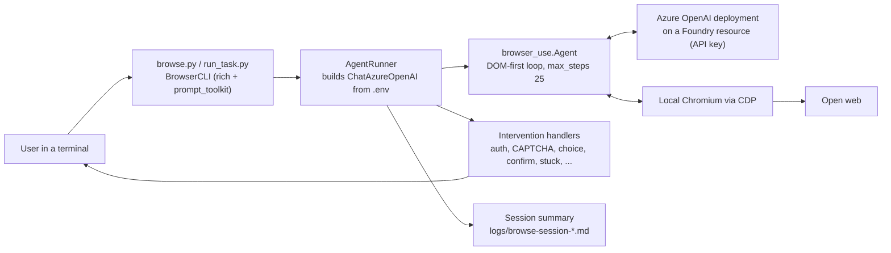

# 06 · Analysis of Sealjay/foundry-browser-use

[Sealjay/foundry-browser-use](https://github.com/Sealjay/foundry-browser-use) is a well-engineered **local command-line
tool**. It drives a **local Chromium** with the open-source [`browser-use`](https://github.com/browser-use/browser-use)
library and an **Azure OpenAI model deployed on a Microsoft Foundry resource**, authenticated with an **API key**. It
doesn't use the Foundry Browser Automation tool, Foundry Agent Service agents, Azure Playwright Workspaces or Computer
Use. Foundry is only the model host. This page summarizes what the repo does, its architecture, its strengths and gaps
(from a code-level review in October 2026), and what this repo adds on top for an end-to-end, governed demo.

---

## At a glance

| | |
|---|---|
| **Purpose** | Interactive terminal agent for open-web tasks: news summaries, shopping comparisons, price finding |
| **Approach** | DOM-first agent loop (`browser_use.Agent`, `use_vision=False` by default, `max_steps=25`) |
| **Model** | An Azure OpenAI deployment on a Foundry (`AIServices`) resource. Default `gpt-4.1-mini`, called with an API key. |
| **Browser** | Local Chromium installed with `playwright install chromium`, controlled over CDP by browser-use |
| **Runtime** | Python 3.12+, `uv` |
| **Infrastructure** | One Bicep file (Foundry account S0 plus a `gpt-4.1-mini` GlobalStandard deployment at 150K TPM) and bash deploy and teardown scripts. Default region `uksouth`. No azd. |
| **Dependencies** | `browser-use` 0.13.10, `langchain-openai` 1.1.14, `playwright` 1.58.0, `rich`, `prompt-toolkit`, `python-dotenv`. **No Azure SDK packages** anywhere in the 295 locked packages. |
| **Quality signals** | MIT license. 61 mock-based unit tests. CI runs ruff and pytest. 84 commits on `main` (43 by the author, 41 by Dependabot). No releases or tags. 1 star, 0 forks. Last human commit 2026-09-23. |

---

## Architecture

1. The user types a task in natural language. There's no scenario catalog; the URL goes in the prompt text.
2. `AgentRunner` reads the endpoint, key, deployment and API version from `.env` and builds browser-use's
   `ChatAzureOpenAI`. It then starts `browser_use.Agent`, which launches a local Chromium.
3. On each step, browser-use extracts the interactive DOM elements as structured text, not screenshots, and asks the
   model for the next action.
4. A step callback classifies the phase and detects stuck loops and repetition. It can pause and ask the human through
   **9 intervention types**: auth, CAPTCHA, choice, confirm, stuck, max steps, checkpoint, confidence and sub-goal.
5. After the task, a second model call summarizes the result and extracts key/value data. Summaries feed the next
   task's context (multi-turn sessions), and the session is exported to Markdown under `logs/`.

---

## Strengths

- **A clean DOM-first design.** No vision by default, which keeps a cheap model viable. The Foundry Browser Automation
  tool takes the same position with accessibility snapshots.
- **Thoughtful human-in-the-loop UX.** Nine intervention types with safe defaults, including confirmation before
  purchases. Keyboard shortcuts and a status footer in the terminal.
- **Multi-turn sessions.** Context carries over between tasks and is exported to Markdown.
- **Good hygiene for a personal project.** 61 unit tests, including meta-tests that flag stale `# type: ignore`
  suppressions. Ruff and pytest in CI, Dependabot, no committed secrets, browser-use telemetry turned off
  (`ANONYMIZED_TELEMETRY=false`), and readable translations of Azure HTTP errors.
- **Portable.** Works with any Azure OpenAI deployment, needs no Playwright workspace, and can reach `localhost`.

---

## Gaps

| Area | Finding |
|---|---|
| **Not the Foundry tool** | No `BrowserAutomationTool`, no prompt or hosted agent, no Playwright Workspaces, no live view, no Foundry tracing. The author chose browser-use while the Foundry tool was still in preview. |
| **Authentication** | API keys only, with `disableLocalAuth: false`. Both deploy scripts print the raw key to the terminal. The system-assigned identity in the Bicep file is never used: no RBAC, no `DefaultAzureCredential`. A policy requiring `disableLocalAuth=true` would break key authentication (an inference; see [05](05-deployment-mcaps.md#policy-considerations)). |
| **Infrastructure** | No azd. A single flat 59-line Bicep file that only creates the model endpoint. No tags, monitoring, budget, private networking or hosting target. Region hard-coded to `uksouth`. |
| **Scenarios** | Free text only. No catalog, no configurable inputs, and `agent.py` hard-codes its task. No form-filling, UI-bug or security scenarios. |
| **Verification** | No success checks or answer keys, so results aren't verified. |
| **Cost** | A README paragraph and a step cap. Token counts are deliberately hidden from the user. No budget, no per-run estimate. |
| **Observability** | No Application Insights or OpenTelemetry. Rich console output and a Markdown session file only. |
| **Tests and delivery** | All tests are mocked: nothing drives a real browser or calls a real endpoint. CI lints and tests only; there's no deployment pipeline and no Bicep validation. |
| **Consistency** | Two LLM client classes for the same job: `langchain_openai.AzureChatOpenAI` in `agent.py` and `browser_use.ChatAzureOpenAI` in `browser_agent/runner.py`. |
| **Platform** | macOS-first (window control through `osascript`). Windows needs WSL or Git Bash. |
| **Security** | Prompt injection through page content is discussed in the author's blog post but isn't mitigated in code or infrastructure. |

---

## What this repo adds

| Dimension | Sealjay/foundry-browser-use | This repo |
|---|---|---|
| **Browser engine** | Local Chromium over CDP (browser-use) | Azure Playwright Workspaces cloud browsers through the **GA Browser Automation tool**. In **local mode**, Edge or Chrome on your PC through the open-source Playwright MCP server, which reaches `localhost`. Local Chromium for the Computer Use comparison. |
| **Agent types** | A local client script | Foundry **prompt agent** (`BrowserAutomationTool`), Foundry **hosted agent** (Agent Framework + **Toolbox**), the hosted agent's code on your PC (**local mode**), and a **Computer Use** loop, all on the same scenarios, with a `compare` command |
| **Foundry features used** | Model hosting only | Agent versions, Responses API, toolbox (MCP), hosted agent code deploy, project connections, live view, tracing |
| **Authentication** | API key, printed by the deploy scripts | Entra ID only: `disableLocalAuth: true`, a `ProjectManagedIdentity` Playwright connection, workspace `localAuth: Disabled`, azd tokens in hooks. Python uses the Azure CLI account that owns the subscription, then azd, so it works when the Azure CLI's default account is in another tenant (verified). |
| **Infrastructure as code** | One Bicep file plus bash scripts | azd with two layers (`foundry` generated by `azd ai agent init --infra`, plus `platform`), hooks, least-privilege RBAC, monitoring, a demo site on Container Apps and a budget |
| **Target sites** | The open web | A purpose-built **Contoso Insurance** site with complex forms, a **bug lab** (12 planted UI defects) and a **security lab** (13 planted, fake issues with a hardened twin), plus any URL you choose |
| **Scenarios** | Free text | **14 YAML scenarios**, levels 1 to 5, with templated inputs, `--url` / `--set` overrides, per-scenario limits, and a web console to browse, run, compare and review them, with a live browser preview |
| **Verification** | None | Automatic checks (`contains`, `regex`, `min_length`, `http_json` read-back through `/api/claims/{ref}`) and answer-key recall for QA and security |
| **Measured evidence** | None published | Per-run tokens, time and cost, cross-checked against Application Insights and Azure Monitor. For example: `02` on the prompt agent in 37 s (≈ $0.014); `05` in all three modes (≈ $0.014 to $0.018); `07` on the hosted agent in 134 s with the claim verified through the API (≈ $0.06); `12` on the hosted agent finding 12 of 13 planted issues in 38 s (≈ $0.015); `13` on the hosted agent in 42 s (≈ $0.015); `09` on the hosted agent in 646 s with 5 of 12 planted defects (≈ $0.16); `07` in local mode against a copy of the site on `localhost` in 47 s (≈ $0.028, no browser minutes). Failures are documented too: `09` on a deliberately broken UI exposed `ToolTimeout`, tool-error and rate-limit behaviour, each with a fix ([04](04-cost-management.md#8-measured-09-ui-bug-hunt-on-a-deliberately-broken-ui)). |
| **QA and security** | None | Exploratory bug hunting, WCAG review, smoke-test plans, a passive security review and a before/after comparison. Deterministic HTTP tools with a host allow-list and an SSRF guard. |
| **Cost control** | README note and step cap | Per-run estimates, scenario limits, bounded recovery, scale to zero, a log cap, budget alerts, `costs --azure` for actual spend ([04](04-cost-management.md)) |
| **Observability** | Console and Markdown log | Foundry traces through the App Insights connection, hosted agent OpenTelemetry, and per-run `events.jsonl`, `report.md` and `result.json` |
| **Human in the loop** | Terminal intervention prompts | A live view to watch and take control, CAPTCHA and MFA handoff instructions, explicit acknowledgement of Computer Use safety checks |
| **Platform** | macOS-first | Windows (pwsh hooks) and Linux/macOS (sh hooks) |

---

## Ideas worth keeping from it

- **DOM-first targeting** instead of screenshots. Accessibility snapshots and refs are the managed equivalent.
- **Explicit human checkpoints** for sign-in, CAPTCHA and "confirm before buying". Here they're implemented as
  instructions, the live-view handoff and safety-check acknowledgement.
- **A cheap default model** (`gpt-4.1-mini`).
- **Minimal telemetry by default.** Keep it in mind for traces too ([07](07-security-and-responsible-ai.md)).

## When its approach is still the better fit

- You want a different LLM, or features specific to browser-use.
- Quick personal experiments without any Foundry project.

Targets that only exist on `localhost` or an intranet used to be a reason too. This repo's local mode now covers them:
it runs the same agent code with the open-source Playwright MCP server and a browser on your PC, while the model stays
in Foundry ([01](01-browser-automation-tool.md#local-mode-the-hosted-agents-code-on-your-pc)).

It isn't a Microsoft-supported path, though, and it doesn't come with Azure governance. If you use it in a governed
tenant, switch it to Entra ID authentication first.
